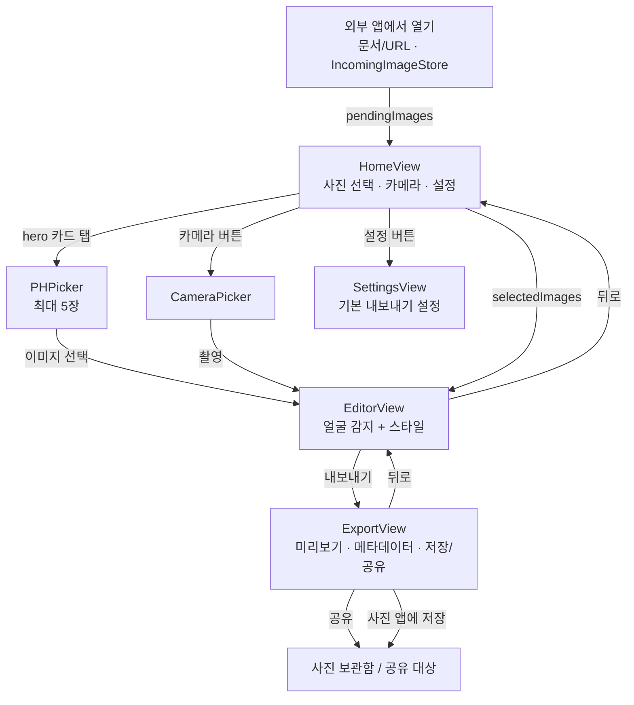
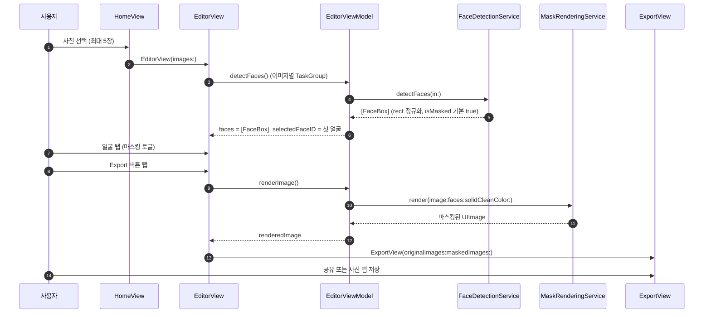
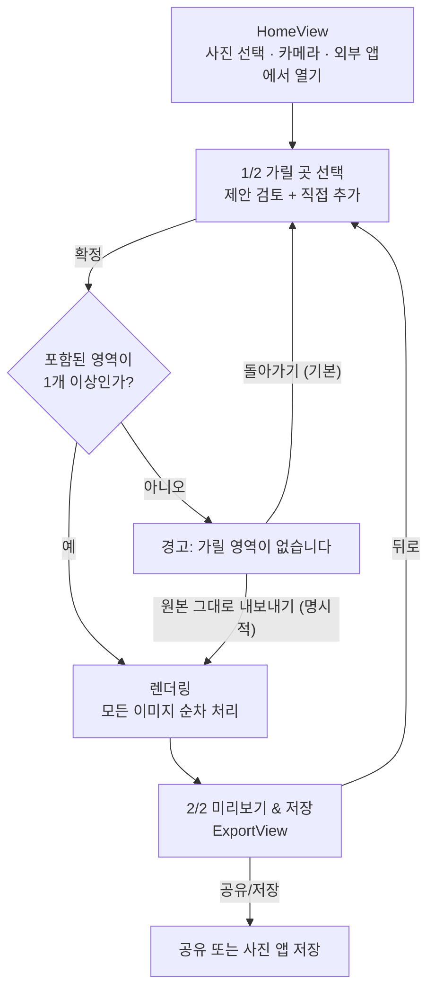
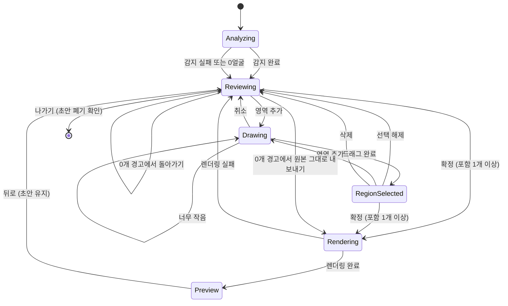

# 수동 마스킹 유저플로우 설계

- 문서 상태: 제안 (구현 전)
- 기준 커밋: `2406b76` (`fix: select draft App Info for metadata sync`)
- 작성일: 2026-11-20
- 범위: 제품 UX, 화면 상태, 데이터/아키텍처 변경 제안, 검증 계획
- 비범위: 실제 소스 코드, 테스트, 로컬라이제이션, 메타데이터 변경. 이 문서는 코드 변경을 포함하지 않는다.
- 경로 표기: 앱 소스 경로는 `iOS/image-incognito/image-incognito/` 기준 상대 경로, 테스트 경로는 `iOS/image-incognito/image-incognitoTests/` 기준 상대 경로로 표기한다.

## TL;DR

- 현재 에디터는 얼굴 감지 결과를 **즉시 마스킹된 상태로 커밋**한다. `FaceBox.isMasked` 기본값이 `true`이고, `EditorViewModel.detectFaces()`가 그대로 매핑한다. 사용자 확인 단계가 없다.
- 목표는 **"감지 → 제안 → 사용자 결정 → 확정"** 이다. 얼굴은 자동 커밋이 아니라 체크된 제안(suggestion)으로 표시한다.
- 에디터를 2단계로 나눈다: **`1/2 가릴 곳 선택`** → 확정 → **`2/2 미리보기 & 저장`** (기존 Export 화면).
- 얼굴 외 임의 영역(번호판, 명찰, 문서, 화면, 문신 등)을 **사각형·원·타원으로 직접 그려 추가**한다. 번호판/문서는 사각형, 감지되지 않은 얼굴은 원/타원이 자연스럽다.
- 스타일은 **영역별 모델**을 기본으로 하고, `모두에게 적용`을 보조 액션으로 둔다. 강도는 영역별로 유지한다.
- 확정 버튼은 포함 개수를 표시하고, **0개면 경고 후 명시적 원본 내보내기만 허용**한다. 조용한 원본 내보내기는 없다.
- OCR/번호판 자동 감지는 **코드에서 이미 제거됐다**(`8f45e38`). 남은 일은 테스트 스캐폴딩, 비추적 로컬 산출물, 릴리스/마케팅 문구 정리다.
- 원본은 항상 보존하고, Export의 길게 눌러 원본 비교는 유지한다.

---

## 1. 현재 유저플로우 분석

### 1.1 화면/상태 맵



현재 내비게이션은 `NavigationStack` 기반이다. Home에서 이미지를 고르면 `EditorView`가 push되고, Editor의 Export 버튼이 렌더링 후 `ExportView`를 push한다. Export의 뒤로 가기는 `dismiss()`로 Editor로 돌아온다.

### 1.2 화면별 현재 동작

| 화면 | 현재 동작 | 코드 근거 |
| :--- | :--- | :--- |
| Home | 히어로 카드 탭으로 PHPicker를 연다. 카메라 촬영, 설정 시트, 외부 앱에서 문서/URL로 열기(`onOpenURL`)를 지원한다. 선택 가능한 사진은 최대 5장이다. | `Presentation/Home/HomeView.swift:16-95`, `:116-171`, `Shared/PhotoPickerRepresentable.swift:54`, `Presentation/Home/HomeViewModel.swift:29-56`, `image_incognitoApp.swift:38-40`, `:49-70` |
| Home | 외부 앱에서 문서/URL로 열린 이미지는 `IncomingImageStore.pendingImages`로 들어오고, 기존 선택을 비운 뒤 새 Editor를 push한다. Share Extension이 아니라 `Info.plist`의 `CFBundleDocumentTypes`/`CFBundleURLTypes`(incognify://)와 `onOpenURL`로 처리한다. | `Presentation/Home/HomeView.swift:49-58`, `Shared/IncomingImageStore.swift`, `iOS/image-incognito/Info.plist` |
| Editor | 진입 시 `TaskGroup`으로 이미지별 `EditorViewModel.detectFaces()`를 병렬 실행한다. | `Presentation/Editor/EditorView.swift:49-55` |
| Editor | 상단 바에 취소, 이미지 카운터, 감지된 얼굴 수, **감지 중에도 활성화되고 렌더링 중에만 비활성화되는** Export 버튼을 표시한다. | `Presentation/Editor/EditorView.swift:73-146` |
| Editor | `TabView` 캐러셀로 이미지를 넘기고, 페이지 점은 현재 위치만 표시한다. | `Presentation/Editor/EditorView.swift:150-173` |
| Editor | 각 얼굴 위에 타원 오버레이를 그리고, 탭하면 `didTapFace`가 마스킹을 토글한다. 토글 후 마스킹 상태가 되면 `AdjustmentSlidersView`가 열린다. | `Presentation/Editor/EditorView.swift:177-236`, `Presentation/Editor/EditorViewModel.swift:137-155`, `Presentation/Editor/AdjustmentSlidersView.swift` |
| Editor | 스타일 pill은 **모든 얼굴에 전역 적용**된다. 강도/크기/이모지는 선택된 얼굴에 적용된다. | `Presentation/Editor/EditorViewModel.swift:158-173`, `:35-72` |
| Editor | 얼굴이 없으면 `NoFaceFoundView` 텍스트만 보여준다. 추가 CTA가 없다. | `Presentation/Editor/EditorStateViews.swift:35-53`, `Presentation/Editor/EditorView.swift:221-224` |
| Editor | Export 버튼은 렌더링 중에만 비활성화되고 감지 중에는 활성화되어 있으며, 확인 다이얼로그 없이 즉시 렌더링한다. | `Presentation/Editor/EditorView.swift:122-142`, `:275-298` |
| Export | 마스킹 결과를 미리보고, 길게 누르면 원본을 보여준다. 위치/EXIF 제거, 원본 해상도 유지 토글을 제공한다. | `Presentation/Export/ExportView.swift:105-229` |
| Export | 공유 시트와 사진 앱 저장을 제공한다. 저장 시 메타데이터 설정을 적용한다. | `Presentation/Export/ExportView.swift:233-269`, `Presentation/Export/ExportViewModel.swift:68-109` |
| Settings | 기본 내보내기 설정(위치 제거, EXIF 제거, 원본 해상도 유지)을 앱 전역에 저장한다. | `Presentation/Settings/SettingsView.swift:57-80`, `Domain/Entities/ExportSettings.swift` |

### 1.3 현재 데이터 흐름



핵심은 `FaceDetectionService`가 얼굴만 감지하고, `FaceBox`가 기본적으로 `isMasked: true`로 생성된다는 점이다. `EditorViewModel.detectFaces()`는 이 값을 그대로 받아 `faces`에 넣고, `selectedFaceID`를 첫 얼굴로 설정한다. 즉 **감지 결과가 곧 마스킹 커밋**이다.

```swift
// Domain/Entities/FaceBox.swift:26-34
init(
    id: UUID = UUID(),
    rect: CGRect,
    isMasked: Bool = true,
    style: MaskingStyle = .blurredGlass,
    intensity: Double = 0.75,
    sizeMultiplier: Double = 1.0,
    selectedEmoji: String = "😎"
)
```

```swift
// Presentation/Editor/EditorViewModel.swift:108-110
let detected = try await detectFacesUseCase.execute(image: sourceImage)
faces = detected.map { FaceBox(id: $0.id, rect: $0.rect, isMasked: $0.isMasked, style: selectedStyle) }
selectedFaceID = faces.first?.id
```

렌더링은 `MaskRenderingService.renderSync`에서 `faces where face.isMasked`만 순회하고, `clipPath(for:)`가 항상 `UIBezierPath(ovalIn:)`을 반환한다. Export는 이 렌더 결과를 그대로 미리보기/저장한다.

### 1.4 문제점

| # | 문제 | 사용자에게 보이는 증상 | 코드 근거 |
| :--- | :--- | :--- | :--- |
| 1 | 감지 즉시 마스킹 커밋 | "원하지 않는 얼굴까지 가려졌는데 저장 전에 되돌리기 어렵다"는 불만. 사용자가 가릴지 말지 결정할 기회가 없다. | `FaceBox.swift:26-34`, `EditorViewModel.swift:108-110` |
| 2 | OCR/번호판 자동 감지가 얼굴 외 숫자/텍스트를 가림 | "온갖 숫자들에 가림표시" 불만. 간판, 날짜, 가격, 번호판까지 마스킹됐다. | `d2b037d`에서 추가, `59673e2`에서 사각형 지원, `8f45e38`에서 제거. 현재 `FaceDetectionService.faceDetectionRequests()`는 얼굴 전용(`Data/Services/FaceDetectionService.swift:47-49`) |
| 3 | 얼굴만 지원, 임의 영역 불가 | 번호판/명찰/문서/화면을 가리려면 얼굴 모양 타원으로만 가릴 수 있다. | `MaskRenderingRepositoryProtocol`은 `faces: [FaceBox]`만 받는다(`Domain/Interfaces/MaskRenderingRepositoryProtocol.swift:11-19`). 일반 영역 엔티티가 없다. |
| 4 | Export가 감지 중에도 활성화, 확인/요약 없음 | 감지가 끝나기 전에도 Export가 가능해 불완전한 제안 상태로 내보낼 수 있다. 0개 마스킹 상태에서도 원본이 그대로 내보내질 수 있고, 사용자는 결과를 확인하지 않고 저장한다. | `EditorView.swift:122-142`, `EditorViewModel.swift:189-203`의 `result ?? sourceImage` 폴백 |
| 5 | 스타일이 전역 적용 | 얼굴과 번호판에 다른 스타일을 쓸 수 없다. | `EditorViewModel.selectStyle`이 `for index in faces.indices`로 전체 변경(`EditorViewModel.swift:158-173`) |
| 6 | 0얼굴 결과가 막다른 길 | "얼굴을 찾지 못했습니다" 텍스트만 보이고, 직접 가릴 방법이 없다. | `EditorStateViews.swift:35-53`, `EditorView.swift:221-224` |
| 7 | 마스크 모양이 타원 하드코딩 | 사각형 번호판/명찰을 자연스럽게 가릴 수 없다. | `FaceOverlayView.maskShape`가 `AnyShape(Ellipse())`(`FaceOverlayView.swift:58-60`), `MaskRenderingService.clipPath`가 `UIBezierPath(ovalIn:)`(`MaskRenderingService.swift:122-124`), `PixelArtMaskView`/`CrystalizeMaskView`도 `clipShape(Ellipse())`(`:117`, `:146`) |
| 8 | Home 문구가 "자동 마스킹"을 약속 | 제품 의도("AI가 찾고, 사용자가 결정")와 카피가 어긋난다. | `Localizable.xcstrings`의 `home.hero.subtitle`: "AI가 자동으로 얼굴을 찾아 마스킹해드립니다." / "AI automatically finds and masks faces in your photos." |
| 9 | 다중 이미지 초안/확인 요약 없음 | 페이지 점은 위치만 보여주고, 어떤 이미지에 몇 곳을 가리는지 알 수 없다. 일부 이미지가 0곳이어도 그대로 내보낸다. | `EditorView.swift:163-173`, `:275-298` |
| 10 | OCR 잔재가 테스트/로컬 산출물에 남음 | 코드는 얼굴 전용인데 테스트 목과 로컬 생성 산출물이 OCR 시대를 암시한다. | `EditorViewModelTests.swift:25-53`, `:107`의 `includeText` 스캐폴딩, `build/metadata_dist/en-US.json`(비추적 로컬 산출물)의 `license plate, text redact` |

> 구분: OCR/번호판 자동 감지는 **이미 코드에서 제거됐다**. `FaceDetectionService.faceDetectionRequests()`는 `VNDetectFaceRectanglesRequest`만 반환하고, `FaceDetectionServiceTests.swift:69-73`이 `VNRecognizeTextRequest`가 없음을 검증한다. 남은 것은 **테스트 스캐폴딩, 비추적 로컬 산출물, 릴리스/마케팅 문구**다.

> 타임라인: `d2b037d` "feat: add license plate and sensitive text redaction detection" → `59673e2` "fix: support rectangular masking and increase filter strength for license plates" → `8f45e38` "fix: remove automatic OCR text redaction". 현재 main은 `8f45e38` 이후 상태다.

---

## 2. 설계 원칙

1. **Detect, don't decide.** 감지는 제안만 한다. 자동 커밋하지 않는다. 모든 마스킹은 사용자가 포함 상태를 확인한 뒤 확정한다.
2. **Explicit confirm.** 렌더링/내보내기 전에 항상 명시적 확정을 받는다. 확정 버튼은 무엇을 몇 곳 가리는지 보여준다.
3. **Mask anything.** 얼굴뿐 아니라 번호판, 명찰, 문서, 화면, 문신 등 임의의 도형 영역(사각형·원·타원)을 지원한다. 감지되지 않은 위험도 사용자가 직접 가릴 수 있어야 한다.
4. **Never lose the original.** 원본은 항상 보존한다. 덮어쓰기 저장은 없다. Export의 길게 눌러 원본 비교를 유지한다.
5. **Consistent batch.** 다중 이미지에서도 같은 규칙을 적용한다. 이미지별 초안을 유지하고, 확정 시 모든 이미지의 포함 개수를 검증한다.
6. **Privacy-safe empty state.** 가릴 영역이 0개일 때 조용히 원본을 내보내지 않는다. 경고하고, 원본 내보내기는 명시적 override로만 허용한다.

---

## 3. 제안 유저플로우

### 3.1 큰 흐름



핵심 변화는 **Export 버튼이 곧 렌더링**이던 흐름을 **검토 → 확정 → 렌더링 → 미리보기**로 분리하는 것이다. 기존 Export 화면은 `2/2 미리보기 & 저장`으로 재사용한다. 화면 구조는 Home → Editor → Export 3개를 유지하고, Editor 내부만 2단계로 나눈다.

### 3.2 Editor 상태 머신



상태 설명:

| 상태 | 의미 | 진입 조건 | 종료 조건 |
| :--- | :--- | :--- | :--- |
| `Analyzing` | 얼굴 감지 중 | 에디터 진입 | 감지 성공/실패/0얼굴 |
| `Reviewing` | 제안 검토 및 편집 | 감지 완료 | 확정, 영역 추가, 나가기 |
| `Drawing` | 도형 그리기 모드 | `영역 추가` | 취소 또는 드래그 완료 |
| `RegionSelected` | 특정 영역이 선택됨 | 드래그 완료 또는 영역 탭 | 선택 해제, 삭제, 확정 |
| `Rendering` | 마스크 베이킹 중 | 확정 | 성공 시 `Preview`, 실패 시 `Reviewing` |
| `Preview` | Export 화면 | 렌더링 완료 | 뒤로(초안 유지) 또는 저장/공유 |

> 구현 메모: `RegionSelected`는 별도 화면이 아니라 `selectedRegionID != nil`로 표현해도 된다. 다이어그램은 UX 상태를 설명하기 위한 것이다. `Preview`는 `ExportView`가 push된 상태에 해당한다.

### 3.3 화면별 상세 스펙

> 디자인 시스템: 새 UI는 기존 토큰/컴포넌트를 사용한다. 색상은 `Color.appPrimary`, `Color.appBackground`, `Color.appLabelPrimary/Secondary/Tertiary`, 간격은 `Spacing.*`, 모서리는 `Radius.element/button/card`, 타이포그래피는 `.appTitle`, `.appBody`, `.appSubheadline`, `.appFootnote` 등 기존 토큰, 버튼은 `PrimaryButton`/`SecondaryButton`, 카드는 `AppCard`, 툴바는 `GlassmorphismToolbar`, 스타일 pill은 `StylePill`을 재사용한다. 인라인 `Color(red:green:blue:)`나 임의 폰트/버튼을 새로 만들지 않는다.

#### 3.3.1 Home

- 히어로 카드와 카메라 버튼은 그대로 유지한다. 최대 5장 선택도 유지한다.
- 카피를 "자동으로 가려드립니다"에서 **"AI가 얼굴을 찾고, 가릴 곳은 직접 정하세요"**로 바꾼다.
- 히어로 카드 아래에 3단계 안내를 추가한다: `사진 선택 → 얼굴/영역 확인 → 미리보기 & 저장`.
- 외부 앱에서 문서/URL로 열어 진입하는 경우에도 같은 Editor 검토 화면을 거친다. 자동 저장/자동 내보내기는 없다.
- 최근 항목은 현재처럼 썸네일을 블러 처리한다. 최근 항목의 "가린 얼굴 수" 배지는 "가린 영역 수"로 의미를 확장할 수 있지만, MVP에서는 기존 배지를 유지해도 된다.

#### 3.3.2 Editor — `1/2 가릴 곳 선택`

**목적:** 감지된 얼굴을 제안으로 보여주고, 사용자가 포함/제외와 추가 영역을 결정한다.

**레이아웃:**

```text
+------------------------------------------------------+
| <  뒤로              1/2 가릴 곳 선택          목록  |
+------------------------------------------------------+
|                                                      |
|          +--------------------------------+          |
|          |                                |          |
|          |      ( 얼굴 A )  [v]           |          |
|          |           ( 얼굴 B )  [v]      |          |
|          |                                |          |
|          |      +------------------+      |          |
|          |      |  직접 그린 영역  | [v]  |          |
|          |      +------------------+      |          |
|          |                                |          |
|          +--------------------------------+          |
|                                                      |
|      ●3    ○2    ○!        (현재 1/3)                |
|                                                      |
|   [블러] [픽셀] [크리스탈] [단색] [이모지]           |
|                                                      |
|   [+ 영역 추가]              [확정 · 3곳 가리기]     |
+------------------------------------------------------+
```

**구성 요소:**

| 요소 | 사양 |
| :--- | :--- |
| 상단 바 | 뒤로, `1/2 가릴 곳 선택`, `목록`(영역 리스트 시트), 이미지 카운터 |
| 캔버스 | 원본 이미지 위에 제안/수동 영역 오버레이. 얼굴은 타원, 수동 영역은 선택한 도형(사각형/원/타원) |
| 제안 링 | 점선 링 + 작은 체크 배지. 포함된 제안은 점선 링 + 반투명 마스크 미리보기, 제외된 제안은 점선 링만 |
| 선택 링 | 실선 강조 링 + 리사이즈 핸들(수동 영역만) + 삭제 아이콘 |
| 페이지 점 | 이미지별 포함 영역 수 배지. 예: `●3`, `○2`, `○!` |
| 스타일 pill | 선택된 영역에 적용. 선택이 없으면 비활성화하고 "영역을 먼저 선택하세요" 안내 |
| 보조 액션 | `모두에게 적용`은 조정 패널 안에 배치 |
| 주 액션 | `확정 · N곳 가리기`. 감지/렌더링 중에는 비활성화 |
| 보조 액션 | `+ 영역 추가`. 마지막 사용 도형을 미리 선택한 채 그리기 모드로 진입 |

> 도형 선택은 `+ 영역 추가`로 그리기 모드에 들어갔을 때 나타나며, 이미 만든 수동 영역은 선택 패널의 `모양`에서 바꾼다. 검토 화면의 하단 툴바에는 도형 picker를 두지 않는다.

**제안 표시 규칙:**

- 감지된 얼굴은 기본 **포함** 상태로 표시한다. 이것은 커밋이 아니라 제안이다.
- 포함된 제안은 점선 링 + 체크 배지 + 반투명 마스크 미리보기를 보여준다. 미리보기는 "이렇게 가려질 예정"을 의미한다.
- 제외된 제안은 점선 링만 보여주고, 마스크 미리보기를 숨긴다. 체크 배지는 빈 원/체크 해제 상태다.
- 선택된 제안은 실선 강조 링을 추가한다. 선택과 포함은 별개다.
- 얼굴 제안은 `source = .detectedFace`, `shape = .ellipse`다.
- 얼굴 제안의 크기는 `sizeMultiplier`로 조정한다. 기본값은 1.0이다.

**탭 동작:**

- 얼굴/영역 본문 탭: 포함/제외 토글 + 해당 영역 선택 + 조정 패널 열기.
- 체크 배지 탭: 본문 탭과 동일하게 동작한다.
- 빈 캔버스 탭: 선택 해제 + 조정 패널 닫기.
- 선택된 영역이 제외 상태가 되면 조정 패널에 "이 영역은 저장되지 않습니다" 경고와 `다시 포함` 버튼을 보여준다. 스타일/강도 편집은 계속 가능하다.
- 얼굴 본문을 길게 눌러도 별도 동작을 추가하지 않는다. 길게 누르기는 Export의 원본 비교에만 사용한다.

#### 3.3.3 Draw mode — `영역 추가`

**목적:** 사용자가 이미지 위에 임의의 도형(사각형/원/타원)을 그려 가릴 영역을 추가한다.

**레이아웃:**

```text
+------------------------------------------------------+
| <  뒤로              1/2 가릴 곳 선택          취소  |
+------------------------------------------------------+
|  화면을 드래그해 가릴 영역을 그리세요.               |
|  모양: [사각형] [원] [타원]                          |
|                                                      |
|          +--------------------------------+          |
|          |                                |          |
|          |       +------------------+     |          |
|          |       |   드래그 중...   |     |          |
|          |       +------------------+     |          |
|          |                                |          |
|          +--------------------------------+          |
|                                                      |
|  손을 떼면 영역이 추가됩니다.                        |
|  이미지 밖으로 나가면 자동으로 보정됩니다.            |
+------------------------------------------------------+
```

**도형 선택:**

- 그리기 모드의 `사각형 / 원 / 타원` segmented picker는 **다음에 그릴 수동 영역의 도형**을 정한다. 이미 만든 영역에는 영향을 주지 않는다. 각 pill은 도형 아이콘+라벨을 가지며, 선택된 pill은 `StylePill`의 선택 스타일로 강조한다. 새로운 시각 언어를 만들지 않는다.
- 기본값은 `rectangle`이다. 마지막으로 사용한 도형을 앱 세션 동안 유지하고, 다음 수동 영역의 기본값으로 쓴다. 이미 만든 영역의 모양 전환은 선택 패널의 `모양` 컨트롤에서만 한다.
- 감지된 얼굴은 항상 `ellipse`이며 이 picker로 바꿀 수 없다. 감지되지 않은 얼굴은 사용자가 `원` 또는 `타원`을 골라 직접 덮는다.

**동작:**

1. `+ 영역 추가`를 누르면 `phase = .drawing`으로 전환한다.
2. 캔버스 위에 반투명 스크림과 안내 문구를 표시한다. 기존 영역은 흐리게 보여주되 편집은 막는다.
3. 사용자가 드래그하면 선택한 도형에 따라 임시 프리뷰를 그린다. 시작점이 이미지 밖이면 드래그를 무시한다.
   - **사각형:** 시작점과 현재점으로 rect를 정의한다.
   - **타원:** 시작점과 현재점을 bounding rect로 하고, 그 안에 타원을 inscribed한다.
   - **원:** 드래그 박스의 중심을 원 중심으로, 반지름 = `max(width, height) / 2`로 잡는다. 사용자가 쓸어낸 영역을 최소한 덮도록 확장하고, 라이브 프리뷰로 확장이 보이게 한다. 이미지 경계를 벗어나면 중심을 클램프하고 필요 시 반지름을 줄여 원 전체가 이미지 안에 들어오게 한다. 원은 항상 `width == height`다.
4. 손을 떼면:
   - 이미지 렌더 영역(`FaceSelectionHitTester.imageRenderRect`) 기준으로 좌표를 클램프한다.
   - 최소 크기(화면 24pt, 정규화 0.01; 원은 지름 기준) 미만이면 추가하지 않고 토스트를 보여준다. 그리기 모드는 유지한다.
   - 통과하면 `MaskRegion(source: .manual, shape: selectedShape, isIncluded: true)`를 생성하고, 선택 상태로 만든다. 원은 정사각형 rect로 저장한다.
   - 그리기 모드를 종료하고 `phase = .regionSelected`로 전환한다.
5. `취소`를 누르면 영역을 추가하지 않고 `phase = .reviewing`으로 돌아간다.
6. 수동 영역은 기본 스타일을 상속한다. 현재 선택된 영역의 스타일을 기본값으로 쓰거나, 마지막으로 사용한 스타일을 앱 세션 동안 유지한다. MVP에서는 **마지막으로 선택한 스타일**을 기본값으로 한다.

**제스처 중재:**

- `phase == .drawing`인 동안에는 `TabView` 페이지 스와이프, 기존 영역 탭/선택, 영역 이동/리사이즈 제스처를 모두 비활성화한다. 캔버스 드래그가 항상 그리기로만 해석되도록 하기 위해서다.
- 그리기 중 페이지를 넘기려면 먼저 `취소`로 그리기 모드를 종료한다.
- 수동 영역 이동/리사이즈가 시작되면 `isRegionGestureActive`를 켜서 페이지 스와이프를 막고, 제스처가 끝나면 해제한다.

**최소 크기 기준:**

- 화면 좌표 기준 24pt × 24pt 이상. 원은 지름 24pt 이상.
- 정규화 좌표 기준 0.01 × 0.01 이상. 원은 지름 0.01 이상.
- 두 조건을 모두 만족해야 한다. 손가락으로 짧게 탭한 수준의 영역은 무시한다.

**도형 규칙:**

- 수동 영역은 **사각형 / 원 / 타원** 중 하나다. 감지된 얼굴은 항상 타원이고, 이 picker로 바꿀 수 없다.
- 사각형은 모서리 라운드 0pt의 직각 사각형이다. 번호판/명찰/문서를 정확히 덮는 데 쓴다.
- 원/타원은 감지되지 않은 얼굴, 곡선 물체, 로고 등에 쓴다. 원은 `width == height` 불변식을 가지며, 드래그한 bounding box의 최대 변을 지름으로 사용해 최소한 쓸어낸 영역을 덮는다.
- 세 도형 모두 기존 5종 스타일(블러/픽셀/크리스탈/단색/이모지)과 영역별 강도를 지원한다.
- 도형 전환은 선택 패널의 `모양` 컨트롤에서만 가능하다. 중심을 유지하고, target이 사각형/타원이면 현재 bounding rect를 그대로 사용하며, target이 원이면 `max(width, height)`를 변으로 하는 정사각형으로 확장해 클램프한다. 전환은 스타일/강도를 바꾸지 않는다.
- 회전은 지원하지 않는다. 필요하면 사용자가 여러 도형을 조합한다.

#### 3.3.4 Region selected — 선택된 영역

**목적:** 선택된 영역의 스타일/강도/크기를 조정하고, 포함 상태를 관리한다.

**표시 방식:** 기존 `AdjustmentSlidersView`처럼 하단 인라인 패널로 표시한다. 선택된 영역이 있을 때만 나타나고, 빈 캔버스를 탭하면 닫힌다. 컨텍스트 툴바는 캔버스 위에 떠 있는 형태가 아니라, 하단 패널 상단의 액션 줄로 통합한다.

**레이아웃:**

```text
+------------------------------------------------------+
| <  뒤로              1/2 가릴 곳 선택          목록  |
+------------------------------------------------------+
|          +--------------------------------+          |
|          |        ( 선택된 영역 )        |          |
|          |        [핸들]        [핸들]    |          |
|          +--------------------------------+          |
|                                                      |
|  선택됨: 직접 그린 도형 · 포함                       |
|  [다시 포함/제외]  [삭제]  [모두에게 적용]           |
|  모양: [사각형] [원] [타원]                          |
|                                                      |
|  스타일: [블러] [픽셀] [크리스탈] [단색] [이모지]    |
|  강도:  ────────●────────  0.75                     |
|  크기:  ────────●────────  1.0  (얼굴만)             |
+------------------------------------------------------+
```

**조정 패널:**

- 스타일은 기존 5종(`blurredGlass`, `pixelArt`, `crystalize`, `solidClean`, `emojiOverlay`)을 그대로 사용한다. 이번 범위에서 새 스타일을 추가하지 않는다.
- 선택된 영역의 스타일, 강도, 이모지, 포함 상태를 보여준다. 수동 영역이면 `모양` 컨트롤도 보여준다.
- 얼굴 제안이면 `크기` 슬라이더(`sizeMultiplier`)를 보여준다. 수동 영역이면 크기 슬라이더를 숨기고 `직접 조작(핸들)` 안내를 보여준다.
- `모양`은 선택된 수동 영역이 있을 때만 패널에 나타나며, 그 영역의 도형을 즉시 바꾼다. 감지된 얼굴은 항상 `ellipse`이며 모양을 바꿀 수 없다.
- 모양 전환은 중심을 유지한다. target이 사각형/타원이면 현재 bounding rect를 그대로 사용하고, target이 원이면 `max(width, height)`를 변으로 하는 정사각형으로 확장한 뒤 이미지 경계로 클램프한다. 전환 후 사용자가 리사이즈할 수 있고, 스타일/강도는 바뀌지 않는다. 전환한 도형은 `defaultShape`에도 반영하고 `editor.shape.switchHint` 안내를 보여준다.
- `모두에게 적용`은 **포함된 모든 영역**에 현재 선택 영역의 스타일과 이모지를 복사한다. 강도는 복사하지 않는다. 사용자가 명시적으로 누를 때만 실행하고, 확인 토스트를 보여준다.
- `삭제`는 선택 영역을 제거한다. 제거 후 다음 영역을 선택하거나 선택을 해제한다. 삭제는 되돌릴 수 없으므로 작은 확인 다이얼로그를 둘 수 있다. MVP에서는 즉시 삭제 + 햅틱 + 토스트("영역을 삭제했습니다")로 충분하다.
- `다시 포함/제외`는 포함 상태를 토글한다. 제외 상태에서도 스타일/강도 편집은 가능하다.

**컨텍스트 툴바:**

- 선택된 영역의 액션은 하단 조정 패널 상단의 액션 줄에 통합한다: `포함/제외`, `스타일`, `삭제`.
- 캔버스 위에 떠 있는 팝오버는 사용하지 않는다. 선택 영역을 가리지 않고, 엄지로 닿기 쉬운 하단에 고정한다.
- `삭제`는 액션 줄에서 바로 실행하고, 실행 취소가 필요하면 토스트에 `실행 취소`를 제공한다. MVP에서는 즉시 삭제 + 햅틱 + 토스트로 충분하다.
- 키보드/보조기기에서는 컨텍스트 툴바 액션을 VoiceOver 커스텀 액션으로도 노출한다.

**직접 조작:**

- 수동 영역: 영역 안쪽을 드래그하면 이동, 네 모서리 핸들을 드래그하면 리사이즈한다. 사각형/타원은 자유롭게 리사이즈하고, 원은 1:1 지름을 유지하며 균등 리사이즈한다.
- 원 리사이즈는 반대쪽 모서리를 고정하고 정사각형 변을 조정한다. 늘어난 변이 이미지 경계를 넘으면 클램프하고, 최소 지름 미만으로 줄이지 않는다.
- 이동/리사이즈 드래그가 시작되면 `isRegionGestureActive = true`로 페이지 스와이프를 막고, 제스처가 끝나면 해제한다.
- 이동/리사이즈는 이미지 렌더 영역 안으로 클램프한다. 최소 크기(화면 24pt, 정규화 0.01) 미만으로 줄이지 않는다.
- 핸들은 44pt 터치 타깃을 확보한다. 시각적 핸들 크기는 12pt여도 히트 영역은 44pt로 넓힌다.
- 얼굴 제안: 이동/리사이즈를 지원하지 않는다. 크기는 `sizeMultiplier` 슬라이더로만 조정한다. 얼굴을 부분적으로 더 가리고 싶으면 수동 도형(원/타원 포함)을 추가한다.

#### 3.3.5 Confirm dialog

**트리거:** `확정 · N곳 가리기` 버튼.

**정상 경로:**

- 포함 영역이 1개 이상이고, 모든 이미지에 포함 영역이 있으면 다이얼로그 없이 바로 렌더링한다.
- 버튼에는 총 포함 개수를 표시한다. 예: `확정 · 3곳 가리기`.
- 다중 이미지에서는 총합을 표시한다. 예: `확정 · 7곳 가리기 (3장)`.
- 확정 버튼은 `phase == .analyzing` 또는 `phase == .rendering`일 때 비활성화한다. 감지 중에는 제안이 아직 확정되지 않았고, 렌더링 중에는 중복 확정을 막아야 한다.
- 다중 이미지에서는 현재 이미지뿐 아니라 **모든 이미지**의 감지가 끝나야 확정할 수 있다. 하나라도 `.analyzing`이면 버튼을 비활성화하고 `모든 사진을 확인하는 중`을 표시한다.

**0개 경고:**

```text
+--------------------------------------------------+
|  가릴 영역이 없습니다                            |
|                                                  |
|  이대로 내보내면 원본과 같은 사진이 저장됩니다.  |
|                                                  |
|              [돌아가기]  [원본 그대로 내보내기]  |
+--------------------------------------------------+
```

- 제목: `가릴 영역이 없습니다`
- 본문: `이대로 내보내면 원본과 같은 사진이 저장됩니다.`
- 기본 버튼: `돌아가기` (cancel role). 다이얼로그를 닫고 검토 화면으로 돌아간다.
- override 버튼: `원본 그대로 내보내기` (destructive role). 명시적으로 눌렀을 때만 렌더링 없이 원본을 Export로 넘긴다.
- 절대 조용히 원본을 내보내지 않는다.

**다중 이미지 일부 0개 경고:**

```text
+--------------------------------------------------+
|  일부 이미지에 가릴 영역이 없습니다              |
|                                                  |
|  2번, 4번 이미지는 원본 그대로 저장됩니다.       |
|  계속할까요?                                     |
|                                                  |
|              [돌아가기]  [계속]                  |
+--------------------------------------------------+
```

- 어떤 이미지가 0개인지 번호로 알려준다.
- `돌아가기`는 첫 번째 문제 이미지로 이동한다.
- `계속`은 해당 이미지를 원본으로 두고 나머지를 렌더링한다. 명시적 override다.
- 모든 이미지가 0개면 단일 0개 경고와 같은 문구를 사용하고, `원본 그대로 내보내기`로 전체를 원본으로 넘긴다.

#### 3.3.6 Rendering

**목적:** 확정된 초안을 실제 픽셀에 베이킹한다.

- 전체 화면 또는 캔버스 위에 진행 오버레이를 표시한다.
- 문구: `2/5장 처리 중` + 진행 바.
- 렌더링 중에는 뒤로 가기, 편집, 확정 버튼을 비활성화한다.
- 이미지별로 순차 렌더링한다. 최대 5장이므로 병렬보다 메모리 피크가 낮고 예측 가능하다.
- 한 이미지라도 실패하면 전체를 중단하고 검토 화면으로 돌아간다. 부분 결과를 Export로 넘기지 않는다.
- 실패 시: `렌더링에 실패했습니다. 다시 시도해 주세요.` + `다시 시도` / `돌아가기`.
- 원본으로의 조용한 폴백은 없다. `result ?? sourceImage` 패턴을 제거한다.
- 성공 시 `renderedImages`를 설정하고 `ExportView`를 push한다.

#### 3.3.7 Export — `2/2 미리보기 & 저장`

**레이아웃:**

```text
+------------------------------------------------------+
| <  뒤로          2/2 미리보기 & 저장                |
+------------------------------------------------------+
|  +------------------------------------------------+  |
|  |                                                |  |
|  |            (마스킹된 결과 이미지)              |  |
|  |                                                |  |
|  +------------------------------------------------+  |
|  v 3곳 가림 · 3024 x 4032                          |
|  길게 눌러 원본과 비교                              |
|                                                      |
|  내보내기 옵션                                       |
|  [x] 위치 정보 제거                                  |
|  [x] EXIF 제거                                       |
|  [x] 원본 해상도 유지                                |
|                                                      |
|  [ 공유 ]                                            |
|  [ 사진 앱에 저장 ]                                  |
+------------------------------------------------------+
```

**동작:**

- 상단 제목을 `2/2 미리보기 & 저장`으로 바꾼다. 기존 `export.title`을 갱신한다.
- 결과 미리보기 카드에 **가린 영역 수**를 표시한다. 예: `3곳 가림`. 다중 이미지면 `3장 · 7곳 가림`.
- 길게 누르면 원본을 보여주는 동작을 유지한다. 손을 떼면 결과로 돌아온다.
- 내보내기 옵션 토글과 공유/저장 액션은 그대로 유지한다.
- 뒤로 가기는 검토 화면으로 돌아간다. 초안은 그대로 유지된다.
- 초안이 바뀌지 않았으면 기존 렌더 결과를 재사용할 수 있다. 바뀌었으면 다시 확정해야 한다.
- 렌더 결과 캐시는 `EditorViewModel`에 둔다. 현재 `EditorView.allRenderedImages`는 Export가 pop될 때 navigation binding에서 nil로 지워지므로(`EditorView.swift:56-68`), `renderedImage`/`renderedRevision`을 VM(또는 별도 캐시)에 보관하고 binding은 화면 전환 트리거로만 쓴다.
- 0개 override로 진입한 경우에도 미리보기는 원본과 동일하다. 배지에 `가린 영역 없음`을 표시하고, 공유/저장 전에 한 번 더 확인한다. 이 확인은 선택 사항이지만, 원본 그대로 내보내는 경로에서는 권장한다.
- **현재 범위:** `ExportViewModel.shareImageTapped`는 현재 미리보기 이미지 1장만 공유한다(`ExportViewModel.swift:100-109`). 저장은 전체 이미지를 저장한다. MVP는 현재 동작을 유지하되, "현재 이미지 공유"와 "전체 공유"를 명시적으로 구분하는 것은 후속 과제로 둔다.

#### 3.3.8 접근성

- **영역 리스트:** `목록` 버튼으로 시트를 열고, 각 행에 `얼굴 제안 · 포함됨 · 블러` 또는 `직접 그린 원 · 포함됨 · 블러`처럼 유형(도형)/상태/스타일을 읽어준다. 행 탭은 선택, 스와이프/컨텍스트 메뉴는 삭제, 체크 버튼은 포함/제외.
- **모양 picker(그리기 모드/선택 패널):** `사각형`, `원`, `타원` 각 옵션에 레이블과 선택 상태(`.isSelected`)를 제공한다. 값 변경 시 "원 선택됨"처럼 announcement로 알린다.
- **VoiceOver 커스텀 액션:** 각 영역에 `포함하기`/`제외하기`, `삭제`, `스타일 변경` 액션을 제공한다. 캔버스 오버레이와 리스트 행 모두 동일한 액션을 가진다.
- **선택 상태 비색상 표현:** 선택은 색상만으로 표시하지 않는다. 실선 링 + 체크 배지 + `선택됨` 접근성 값 + 리스트 행 강조를 함께 사용한다. 제안/포함/제외도 점선/실선/체크 상태로 구분한다.
- **44pt 터치 타깃:** 체크 배지, 삭제 버튼, 리사이즈 핸들, 스타일 pill은 최소 44×44pt 터치 영역을 확보한다. 핸들의 시각 크기는 12pt여도 히트 영역은 44pt로 넓힌다.
- **Reduce Motion:** `@Environment(\.accessibilityReduceMotion)`을 확인하고, 마스크/링 전환의 확대·이동 애니메이션을 끈다. 페이드만 사용하거나 즉시 전환한다. 페이지 전환도 과한 슬라이드 애니메이션을 피한다.
- **Dynamic Type:** 확정 버튼/배지의 count 라벨이 잘리지 않도록 줄바꿈 또는 짧은 라벨(`3곳`)을 허용한다. 큰 글자에서 상단 바가 깨지지 않도록 `minimumScaleFactor`는 최소한으로 사용한다.
- **VoiceOver 순서:** 상단 바 → 캔버스 영역 → 페이지 인디케이터 → 스타일 pill → 주 액션 순으로 읽도록 `.accessibilitySortPriority`를 지정한다. 감지 완료 시 "얼굴 3개를 찾았습니다. 3개 모두 포함되어 있습니다."를 announcement로 알린다.
- **햅틱 의존 금지:** 포함/제외/삭제/확정의 결과는 시각/청각/VoiceOver로도 확인 가능해야 한다. 햅틱은 보조 수단이다.

#### 3.3.9 다중 이미지 동작

- **초안 분리:** 이미지마다 독립된 `EditorViewModel`을 두고, `regions`, `selectedRegionID`, `phase`, `draftRevision`을 이미지별로 유지한다. 페이지를 넘겨도 초안이 섞이지 않는다.
- **페이지 표시:** 상단 바에 `현재/전체`를 표시하고, 페이지 점에는 이미지별 포함 영역 수를 배지로 표시한다. 예: `●3`, `○2`, `○!`. `○!`는 포함 영역이 0개인 이미지다. VoiceOver 값은 "2번째 이미지, 2곳 가림"처럼 읽는다.
- **현재 이미지 요약:** 상단 바에 `3/5 · 3곳`처럼 현재 이미지의 포함 개수를 함께 표시한다. 전체 합계는 확정 버튼에 표시한다.
- **확정 전제:** 모든 이미지의 감지가 끝나야 한다. 한 이미지라도 `phase == .analyzing`이면 확정 버튼을 비활성화하고 `모든 사진을 확인하는 중`을 표시한다.
- **확정 집계:** 확정 시 모든 이미지의 포함 개수를 합산한다. 하나라도 0개면 3.3.5의 부분 0개 경고를 띄우고, 문제 이미지 번호를 나열한다. 모두 0개면 단일 0개 경고를 띄운다.
- **렌더링:** 이미지 순서대로 순차 렌더링하고 `2/5장 처리 중` 진행을 표시한다. 한 이미지가 실패하면 전체를 중단하고 검토로 돌아간다. 부분 결과를 Export로 넘기지 않는다. 재시도는 전체를 다시 렌더링한다(MVP).
- **뒤로 가기:** Export에서 뒤로 가면 모든 이미지의 초안이 유지된다. 한 이미지만 수정해도 다른 이미지의 초안은 그대로다. 재확정 시 MVP는 전체를 다시 렌더링하고, 최적화 단계에서 `draftRevision`이 바뀐 이미지만 렌더링한다.
- **`모두에게 적용` 범위:** 현재 이미지의 포함된 모든 영역에만 적용한다. 다른 이미지에는 적용하지 않는다. 다른 이미지까지 일괄 적용하려면 별도 확인이 필요한 기능으로 분리한다(이번 범위에서는 제외).
- **외부 앱에서 열기:** 검토 중 외부 앱에서 문서/URL로 이미지가 열리면 현재 초안을 유지한 채 새 이미지를 추가할지, 현재 초안을 버리고 새 Editor를 열지 확인한다. 현재 코드는 `onOpenURL` 수신 시 기존 내비게이션을 pop하고 새 Editor를 push하므로, 초안 유실을 막는 확인 다이얼로그가 필요하다.

#### 3.3.10 Interaction table

| 제스처/컨트롤 | 결과 | 상태 변경 |
| :--- | :--- | :--- |
| 얼굴/영역 본문 탭 | 포함/제외 토글, 해당 영역 선택, 조정 패널 열기 | `region.isIncluded.toggle()`, `selectedRegionID = id`, `phase = .regionSelected` |
| 체크 배지 탭 | 본문 탭과 동일 | 동일 |
| 빈 캔버스 탭 | 선택 해제, 조정 패널 닫기 | `selectedRegionID = nil`, `phase = .reviewing` |
| `+ 영역 추가` | 그리기 모드 진입 | `phase = .drawing`, `isDrawing = true` |
| 그리기 모드 진입 | 캐러셀 페이지 스와이프, 기존 영역 탭/선택, 이동/리사이즈 비활성화 | `phase == .drawing` |
| 모양 picker 선택 | 그리기 모드: 다음 수동 영역의 기본 도형 변경. 선택 패널: 현재 수동 영역의 도형 변경 | 그리기 모드: `defaultShape = shape`; 선택 패널: `switchShape(id:to:)` |
| 그리기 드래그 | 임시 도형 표시 | `draftRect` 갱신 |
| 원 그리기 드래그 | bounding box 중심/최대변 반지름으로 확장, 경계 클램프 | `draftRect`를 정사각형으로 보정 |
| 수동 영역 이동/리사이즈 드래그 시작 | 페이지 스와이프 비활성화 | `isRegionGestureActive = true`; 제스처 종료 시 `false` |
| 그리기 손 떼기 (유효) | 수동 도형 추가, 선택 | `regions.append(...)`, `selectedRegionID = newID`, `phase = .regionSelected`, `draftRevision += 1` |
| 그리기 손 떼기 (너무 작음) | 추가하지 않음, 토스트 | `phase = .drawing` 유지 |
| 그리기 `취소` | 추가하지 않고 복귀 | `phase = .reviewing`, `draftRect = nil` |
| 스타일 pill 탭 | 선택 영역에 스타일 적용 | `region.style = style`, `draftRevision += 1` |
| `모두에게 적용` | 포함된 모든 영역에 스타일/이모지 복사 | `regions[i].style = selected.style`, `draftRevision += 1` |
| 강도 슬라이더 | 선택 영역 강도 변경 | `region.intensity = value`, `draftRevision += 1` |
| 크기 슬라이더 (얼굴) | 선택 얼굴 크기 변경 | `region.sizeMultiplier = value`, `draftRevision += 1` |
| 수동 영역 내부 드래그 | 이동 | `region.rect = clamped(rect + delta)`, `draftRevision += 1` |
| 수동 영역 모서리 핸들 드래그 | 리사이즈 (사각형/타원은 자유) | `region.rect = clamped(resizedRect)`, `draftRevision += 1` |
| 원 모서리 핸들 드래그 | 1:1 지름 유지, 반대쪽 모서리 고정 | `region.rect`를 정사각형으로 보정, `draftRevision += 1` |
| `모양` 전환 (선택 패널) | 수동 영역 도형 변경, 중심 유지, 스타일/강도 유지 | `region.shape = target`, `region.rect = converted`, `defaultShape = target`, `draftRevision += 1` |
| `삭제` | 선택 영역 제거 | `regions.removeAll { $0.id == id }`, `selectedRegionID = nil`, `draftRevision += 1` |
| `확정 · N곳` | 검증 후 렌더링 | `phase = .rendering` 또는 경고 다이얼로그 |
| 경고 `돌아가기` | 검토로 복귀 | `phase = .reviewing` |
| 경고 `원본 그대로 내보내기` | 원본으로 Export 진행 | `phase = .rendering`, `allowEmpty = true` |
| Export `뒤로` | 검토로 복귀, 초안 유지 | `phase = .reviewing`, `renderedImages` 유지 |
| Export 길게 누르기 | 원본 비교 | `isShowingOriginal = true` (일시적) |
| 페이지 스와이프 | 다른 이미지로 이동 | `currentIndex` 변경, 각 VM 초안 유지 |
| 페이지 점 탭 | 해당 이미지로 이동 | `currentIndex` 변경 |
| `목록` | 영역 리스트 시트 열기 | `isShowingRegionList = true` |
| 리스트 행 탭 | 해당 영역 선택 | `selectedRegionID = id` |
| 리스트 체크 토글 | 포함/제외 | `region.isIncluded.toggle()` |

### 3.4 UI copy table

> `Localizable.xcstrings`의 `sourceLanguage`는 `ko`다. 아래 영어는 의미 참고용이며, 구현 시 **en/ko/ja/es/zh-Hans 5개 로케일을 모두 채워야 한다**. 키는 문맥 접두사가 있는 dot-notation을 사용한다. count/format 문자열은 String Catalog의 포맷/plural 규칙을 등록한다.

| Key | 한국어 (ko) | English (en) | 비고 |
| :--- | :--- | :--- | :--- |
| `home.hero.subtitle` | AI가 얼굴을 찾고, 가릴 곳은 직접 정하세요. | AI finds faces. You decide what to hide. | 기존 "자동 마스킹" 문구 교체 |
| `home.hero.steps` | 사진 선택 → 얼굴/영역 확인 → 미리보기 & 저장 | Pick photos → Review faces and areas → Preview and save | 신규 3단계 안내 |
| `editor.review.title` | 1/2 가릴 곳 선택 | 1/2 Choose what to hide | 상단 바 |
| `editor.review.subtitle` | AI가 찾은 얼굴을 확인하고, 필요한 곳을 직접 추가하세요. | Review the faces AI found and add anything else you need to hide. | 검토 화면 안내 |
| `editor.addRegion` | 영역 추가 | Add area | 주 보조 액션 |
| `editor.shape.title` | 모양 | Shape | 그리기 모드/선택 패널 |
| `editor.shape.rectangle` | 사각형 | Rectangle | 그리기 모드/선택 패널 |
| `editor.shape.circle` | 원 | Circle | 그리기 모드/선택 패널 |
| `editor.shape.ellipse` | 타원 | Ellipse | 그리기 모드/선택 패널 |
| `editor.shape.switchHint` | 도형을 바꾸면 영역이 조정됩니다. | Changing the shape adjusts the area. | 모양 전환 안내 |
| `editor.draw.instruction` | 화면을 드래그해 가릴 영역을 그리세요. | Drag on the photo to mark an area to hide. | 그리기 모드 |
| `editor.draw.cancel` | 취소 | Cancel | 그리기 모드 |
| `editor.draw.tooSmall` | 조금 더 크게 그려주세요. | Draw a slightly larger area. | 최소 크기 미달 |
| `editor.region.included` | 포함됨 | Included | 상태 라벨 |
| `editor.region.excluded` | 제외됨 | Excluded | 상태 라벨 |
| `editor.region.include` | 다시 포함 | Include again | 제외 상태에서 |
| `editor.region.exclude` | 제외하기 | Exclude | 포함 상태에서 |
| `editor.region.delete` | 삭제 | Delete | 컨텍스트 툴바 |
| `editor.region.deleteToast` | 영역을 삭제했습니다. | Area deleted. | 토스트 |
| `editor.region.manual` | 직접 그린 도형 | Manual shape | 리스트/패널 |
| `editor.region.face` | 얼굴 제안 | Face suggestion | 리스트/패널 |
| `editor.style.applyToAll` | 모두에게 적용 | Apply to all | 보조 액션 |
| `editor.style.appliedToAll` | 포함된 모든 영역에 적용했습니다. | Applied to all included areas. | 토스트 |
| `editor.style.selectRegionFirst` | 영역을 먼저 선택하세요. | Select an area first. | 선택 없음 |
| `editor.confirm` | 확정 · %d곳 가리기 | Confirm · Hide %d areas | count 포맷 |
| `editor.confirm.multi` | 확정 · %d곳 가리기 (%d장) | Confirm · Hide %d areas (%d photos) | 다중 이미지 |
| `editor.confirmEmpty.title` | 가릴 영역이 없습니다 | Nothing to hide | 경고 제목 |
| `editor.confirmEmpty.message` | 이대로 내보내면 원본과 같은 사진이 저장됩니다. | This will export the photo without any masks. | 경고 본문 |
| `editor.confirmEmpty.back` | 돌아가기 | Go back | 기본(cancel) |
| `editor.confirmEmpty.exportOriginal` | 원본 그대로 내보내기 | Export without masks | 명시적 override |
| `editor.confirmPartial.title` | 일부 이미지에 가릴 영역이 없습니다 | Some photos have nothing to hide | 다중 이미지 경고 |
| `editor.confirmPartial.message` | %@번 이미지는 원본 그대로 저장됩니다. 계속할까요? | Photos %@ will be exported without masks. Continue? | 이미지 번호 목록 |
| `editor.confirmPartial.continue` | 계속 | Continue | override |
| `editor.noFaceFound.title` | 얼굴을 찾지 못했어요 | No faces found | 0얼굴 |
| `editor.noFaceFound.message` | 직접 가릴 곳을 선택하세요. | Mark anything you want to hide. | 0얼굴 |
| `editor.noFaceFound.addRegion` | 영역 추가 | Add area | CTA |
| `editor.detectionFailed.title` | 얼굴 감지에 실패했어요 | Face detection failed | 감지 실패 |
| `editor.detectionFailed.message` | 직접 가릴 곳을 선택할 수 있어요. | You can still mark areas manually. | 감지 실패 |
| `editor.rendering.progress` | %d/%d장 처리 중 | Processing %d of %d | 렌더링 |
| `editor.rendering.failed` | 렌더링에 실패했습니다. 다시 시도해 주세요. | Rendering failed. Please try again. | 실패 |
| `editor.rendering.retry` | 다시 시도 | Try again | 실패 |
| `editor.pageIndicator.accessibility` | %d번째 이미지, %d곳 가림 | Photo %d, %d areas hidden | VoiceOver |
| `editor.regionList.title` | 가릴 영역 | Areas to hide | 리스트 시트 |
| `editor.regionList.empty` | 아직 추가한 영역이 없습니다. | No areas yet. | 리스트 시트 |
| `editor.cancel` | 취소 | Cancel | 기존 키 유지 |
| `export.title` | 2/2 미리보기 & 저장 | 2/2 Preview & save | 기존 키 갱신 |
| `export.maskedAreas` | %d곳 가림 | %d areas hidden | 결과 배지 |
| `export.maskedAreas.zero` | 가린 영역 없음 | No areas masked | 0개 override |
| `export.compareHint` | 길게 눌러 원본과 비교 | Press and hold to compare with the original | 기존 동작 안내 |
| `export.backToReview` | 가릴 곳 다시 선택 | Edit areas | 뒤로 가기 보조 문구 |

> 기존 키 `editor.noFaceFound`는 `editor.noFaceFound.title`로 정리하고, 기존 `editor.export`는 제거하거나 `editor.confirm`으로 대체한다. `editor.preparing`은 `editor.rendering.progress`로 대체한다. 기존 `export.completionBadge`는 `export.maskedAreas`로 대체한다.

> 영역 접근성 레이블은 `editor.region.manual` + `editor.shape.*`를 조합해 `직접 그린 원 · 포함됨 · 블러`처럼 만든다. 감지 얼굴은 `editor.region.face`를 쓴다.

### 3.5 Edge cases & recovery

| 상황 | 감지/트리거 | 처리 | 복구 |
| :--- | :--- | :--- | :--- |
| 감지 실패 | Vision 에러/타임아웃 | `detectionFailed = true`, `phase = .reviewing`. 제안 없이 수동 플로우 제공 | `영역 추가` CTA, 재시도 버튼 |
| 0얼굴 | 감지 성공, 결과 0 | "얼굴을 찾지 못했어요. 직접 가릴 곳을 선택하세요." + `영역 추가` | 수동 도형 추가 |
| 0개 포함 | 사용자가 모두 제외 | 확정 시 경고. 기본 `돌아가기`, override `원본 그대로 내보내기` | 검토로 복귀 또는 명시적 원본 내보내기 |
| 너무 작은 도형 | 드래그 거리 < 24pt 또는 정규화 < 0.01 (원은 지름) | 추가하지 않고 토스트. 그리기 모드 유지 | 다시 크게 그리기 |
| 이미지 밖 드래그 | 시작점/끝점이 렌더 영역 밖 | 렌더 영역과 교집합으로 클램프. 교집합이 최소 크기 미만이면 거부 | 다시 그리기 |
| 원이 가장자리에 걸침 | 원 드래그/리사이즈가 경계 밖 | 중심을 클램프하고 필요 시 반지름을 줄여 원 전체가 이미지 안에 들어오게 한다 | 다시 그리기/이동 |
| 길쭉한 드래그(원) | width ≠ height | 중심 유지, 지름 = `max(width, height)`로 확장해 쓸어낸 영역을 최소한 덮는다 | 라이브 프리뷰 확인 |
| 타원→원 전환 | 모양 전환 | 중심 유지, `max(width, height)` 변의 정사각형으로 확장 후 경계 클램프 | 필요 시 리사이즈 |
| 원 리사이즈 | 모서리 핸들 | 1:1 지름 유지, 반대쪽 모서리 고정, 경계 클램프 | 다시 리사이즈 |
| 영역이 많음 | 50개 초과 | 소프트 캡 50개. 초과 시 추가 버튼 비활성화 + 안내 | 기존 영역 삭제/통합 |
| 다중 이미지 일부 0개 | 일부 이미지에 포함 영역 없음 | 확정 시 이미지 번호와 함께 경고. `돌아가기`/`계속` | 해당 이미지로 이동해 추가 |
| 다중 이미지 전체 0개 | 모든 이미지 0개 | 단일 0개 경고와 동일. `원본 그대로 내보내기`만 허용 | 검토로 복귀 |
| 방향(orientation) | 세로/가로 사진, EXIF orientation | 감지/렌더링 전에 orientation 정규화. 수동 좌표는 표시 좌표계 기준 | 자동 보정. 테스트로 검증 |
| 뒤로/취소 | 검토에서 뒤로 | 초안이 있으면 "편집 내용을 버릴까요?" 확인. `계속 편집`/`나가기` | 나가면 초안 폐기 |
| 시스템 뒤로 제스처 | 초안이 있는 상태에서 swipe-back | 커스텀 상단 바 뒤로 버튼과 시스템 swipe-back 모두 같은 확인 다이얼로그를 거쳐야 한다. `draftRevision > 0`일 때 interactive pop을 비활성화하고, 확인 없이는 나갈 수 없게 한다 | `계속 편집`/`나가기` |
| Export에서 뒤로 | Export에서 뒤로 | 검토로 복귀. 초안 유지. 렌더 결과는 VM 캐시에 유지 | 다시 확정 가능 |
| 확정 후 재편집 | Export에서 뒤로 후 수정 | `draftRevision` 변경 시 렌더 캐시 무효화. 다시 확정 필요 | 재렌더링 |
| 겹치는 영역 | 얼굴/수동 도형이 겹침 | 배열 순서대로 렌더. 나중 영역이 위에 그려짐. 자동 병합 없음 | 영역 이동/삭제 |
| 메모리/성능 | 5장 대형 사진 | 순차 렌더링, `autoreleasepool`, 진행 표시. 중간 결과 즉시 해제 | 실패 시 재시도 |
| 외부 앱에서 열기 | 편집 중 외부 앱에서 문서/URL로 이미지 열기 | 현재 코드는 `onOpenURL` 수신 시 기존 선택을 비우고 새 Editor를 push. 초안이 사라질 수 있다 | 확인 다이얼로그 또는 새 세션으로 대체 안내 |
| 시뮬레이터 | Vision이 얼굴을 찾지 못함 (`AGENTS.md` 제약) | 시뮬레이터에서는 0얼굴/수동 플로우만 검증. 얼굴 감지는 실기기 | 실기기 QA |
| Reduce Motion | 접근성 설정 | 마스크/링 전환 애니메이션 최소화. 페이드만 사용 | 설정 존중 |
| VoiceOver | 영역 탐색 | 영역 리스트 + 커스텀 액션(포함/제외, 삭제, 스타일) | 리스트에서 편집 |
| Dynamic Type | 큰 글자 | 상단/하단 바가 잘리지 않도록 스크롤/축약. 버튼 라벨은 줄바꿈 허용 | 레이아웃 조정 |
| 다크 모드 | 시스템 설정 | 기존 디자인 토큰 사용. 임시 색상 하드코딩 금지 | 토큰 검증 |

---

## 4. 데이터/아키텍처 변경 제안

### 4.1 `MaskRegion` 엔티티

현재 `FaceBox`는 감지 결과와 편집 상태를 동시에 들고 있다. 이 구조가 "감지 = 커밋"을 만든다. 제안은 **감지 DTO(`FaceBox`)와 편집 모델(`MaskRegion`)을 분리**하는 것이다.

```swift
// Domain/Entities/MaskRegion.swift
nonisolated struct MaskRegion: Identifiable, Sendable, Equatable {
    enum Source: Sendable, Equatable {
        case detectedFace
        case manual
    }

    enum Shape: Sendable, Equatable {
        case rectangle
        case ellipse
        case circle
    }

    let id: UUID
    var source: Source
    var shape: Shape
    /// 정규화 좌표, top-left origin, 0...1.
    var rect: CGRect
    var isIncluded: Bool
    var style: MaskingStyle
    var intensity: Double
    /// 감지된 얼굴에만 사용. 수동 영역은 1.0.
    var sizeMultiplier: Double
    var selectedEmoji: String
    /// 감지된 얼굴과의 연결. 수동 영역은 nil.
    var linkedFaceID: UUID?

    init(
        id: UUID = UUID(),
        source: Source,
        shape: Shape,
        rect: CGRect,
        isIncluded: Bool = true,
        style: MaskingStyle = .blurredGlass,
        intensity: Double = 0.75,
        sizeMultiplier: Double = 1.0,
        selectedEmoji: String = "😎",
        linkedFaceID: UUID? = nil
    ) { ... }
}
```

**`FaceBox`와의 관계:**

| 현재 `FaceBox` 필드 | `MaskRegion` 대응 | 비고 |
| :--- | :--- | :--- |
| `id` | `id` | 감지 결과의 id를 유지하거나 `linkedFaceID`로 연결 |
| `rect` | `rect` | 정규화 top-left origin 유지 |
| `isMasked` | `isIncluded` | 의미를 "마스킹됨"에서 "포함됨"으로 변경 |
| `style` | `style` | 영역별 스타일 |
| `intensity` | `intensity` | 영역별 강도 |
| `sizeMultiplier` | `sizeMultiplier` | 얼굴만 사용 |
| `selectedEmoji` | `selectedEmoji` | 이모지 스타일 |
| 없음 | `source` | `detectedFace` / `manual` |
| 없음 | `shape` | `rectangle` / `ellipse` / `circle` |
| 없음 | `linkedFaceID` | 감지 결과 추적 |

**권장 정리:**

- `FaceBox`는 감지 결과 DTO로 축소한다: `id`, `rect`만 유지하거나, 최소한 `isMasked`/`style`/`intensity` 같은 편집 상태를 제거한다.
- `FaceBox.isMasked` 기본값 `true`는 제거한다. 감지 결과가 마스킹 상태를 들고 있으면 같은 버그가 재발한다.
- `MaskRegion`은 `nonisolated` + `Sendable`을 유지한다. `CGRect`/`UUID`/`String`/`enum`은 값 타입이라 안전하다.
- `MaskRegion`의 `rect` 불변식: `0...1` 범위, `width/height > 0`, top-left origin. 생성 시 클램프한다.
- `shape == .circle`이면 `width == height`를 항상 유지한다. 아닌 값이 들어오면 `RegionGeometry.squareRect(center:side:)`로 정사각형화한 뒤 클램프한다.
- `RegionGeometry`에 `squareRect(center:side:)`, `clampCircle(center:radius:in:)`, `convertShape(_:to:keepingCenter:)` 헬퍼를 둔다. 변환/클램프 규칙은 UI와 렌더러가 같은 헬퍼를 사용한다.
- `MaskRegion`에 `isManual`/`isFace` 편의 프로퍼티를 둘 수 있다. 수동 영역의 기본 도형은 `rectangle`이고, 마지막 사용 도형은 세션 상태로 유지한다.

### 4.2 렌더러 변경

**프로토콜:**

```swift
protocol MaskRenderingRepositoryProtocol: Sendable {
    func render(
        image: UIImage,
        regions: [MaskRegion],
        solidCleanColor: UIColor
    ) async throws -> UIImage
}
```

**렌더링 규칙:**

| 항목 | 현재 | 제안 |
| :--- | :--- | :--- |
| 입력 | `faces: [FaceBox]` | `regions: [MaskRegion]` |
| 포함 필터 | `face.isMasked` | `region.isIncluded` |
| 클립 모양 | 항상 `UIBezierPath(ovalIn:)` | `.rectangle` → rect, `.ellipse`/`.circle` → oval (circle은 정사각형 rect) |
| 스타일 | `face.style` | `region.style` |
| 강도 | `face.intensity` | `region.intensity` |
| 크기 | `face.sizeMultiplier` | 얼굴만 `sizeMultiplier`, 수동은 rect 그대로 |
| Z-order | 배열 순서 | 배열 순서 유지. 선택 시 재정렬 금지 |
| 클램프 | `pointRect`에서 intersection | 생성 시 + 렌더 시 이중 클램프 |
| Orientation | `normalizeOrientation` | 유지 |

**구현 포인트:**

- `clipPath(for:)`를 `clipPath(for shape: MaskRegion.Shape, rect: CGRect)`로 바꾼다. `.rectangle`은 `UIBezierPath(rect:)`, `.ellipse`/`.circle`은 `UIBezierPath(ovalIn:)`을 쓴다. 원은 정사각형 rect이므로 oval이 원이 된다.
- `pointRect`를 `pointRect(for region: MaskRegion, imageSize: CGSize)`로 바꾼다. 얼굴은 `sizeMultiplier`를 적용하고, 수동은 적용하지 않는다. 둘 다 이미지 경계와 교집합한다.
- `renderSync`의 `for face in faces where face.isMasked`를 `for region in regions where region.isIncluded`로 바꾼다.
- `applyBlur`, `applyPixelArt`, `applyCrystalize`, `applySolid`는 `rect`와 `region`을 받도록 시그니처를 바꾼다. `applyEmojiOverlay`도 동일하다.
- `applySolid`는 `clipPath`를 사용하므로 사각형/원/타원이 자동으로 반영된다.
- `PixelArtMaskView`/`CrystalizeMaskView`의 SwiftUI 미리보기는 `clipShape`를 `AnyShape`로 바꾼다. 현재 `Ellipse()` 하드코딩을 제거하고 `Rectangle`/`Ellipse`를 shape에 맞게 쓴다.
- 겹치는 영역은 배열 순서대로 그린다. 선택 상태는 렌더 순서에 영향을 주지 않는다. 수동 영역은 감지 얼굴 뒤에 append한다.
- 사각형은 라운드 0pt. 번호판/명찰을 정확히 덮는다. 원/타원은 oval 클립으로 모서리를 칠하지 않는다.
- 얼굴 타원은 현재와 동일하게 `sizeMultiplier`만큼 확장한다.
- `render` 실패 시 `sourceImage`로 폴백하지 않는다. 에러를 던지고 UI가 처리한다.

**테스트:**

- 사각형/원/타원이 각각 올바른 클립으로 렌더되는지 픽셀/경로 단위로 검증한다.
- 사각형은 모서리 픽셀이 마스킹되고, 원/타원은 bounding box 모서리 픽셀이 마스킹되지 않는지 검증한다.
- 원은 정사각형 rect를 사용하고, 리사이즈 후에도 1:1을 유지하는지 검증한다.
- 두 영역에 서로 다른 스타일을 적용했을 때 각각 다르게 렌더되는지 검증.
- 제외된 영역이 렌더되지 않는지 검증.
- 경계를 벗어난 rect가 이미지 안으로 클램프되는지 검증.
- 겹치는 영역의 z-order가 배열 순서와 일치하는지 검증.
- orientation이 `.right`/`.left`인 이미지에서 마스크 위치가 맞는지 검증.

### 4.3 `EditorViewModel` 상태 변경

**현재:**

- `faces: [FaceBox]`
- `selectedFaceID: UUID?`
- `selectedStyle: MaskingStyle`
- `intensity`, `sizeMultiplier`, `selectedEmoji`는 선택된 얼굴의 computed property
- `showAdjustmentSliders: Bool`
- `isRendering`, `renderedImage`

**제안:**

```swift
@MainActor
@Observable
final class EditorViewModel {
    enum Phase: Sendable, Equatable {
        case analyzing
        case reviewing
        case drawing
        case regionSelected
        case rendering
    }

    var regions: [MaskRegion] = []
    var selectedRegionID: UUID?
    var phase: Phase = .analyzing
    var isDrawing: Bool = false
    var isRegionGestureActive: Bool = false
    var detectionFailed: Bool = false
    var defaultStyle: MaskingStyle = .blurredGlass
    var defaultShape: MaskRegion.Shape = .rectangle
    var draftRevision: Int = 0
    var renderedRevision: Int?
    var renderedImage: UIImage?

    var includedRegionCount: Int { regions.filter(\.isIncluded).count }
    var manualRegionCount: Int { regions.filter { $0.source == .manual }.count }
    var hasIncludedRegions: Bool { includedRegionCount > 0 }

    func detectFaces() async throws
    func toggleInclusion(id: UUID)
    func selectRegion(id: UUID)
    func addManualRegion(rect: CGRect, shape: MaskRegion.Shape) throws
    func switchShape(id: UUID, to shape: MaskRegion.Shape)
    func moveRegion(id: UUID, to rect: CGRect)
    func resizeRegion(id: UUID, to rect: CGRect)
    func deleteRegion(id: UUID)
    func applyStyle(_ style: MaskingStyle, to id: UUID)
    func applyStyleToAll(_ style: MaskingStyle)
    func confirm(allowEmpty: Bool) async throws -> UIImage
}
```

**상태 변경 규칙:**

- `detectFaces()`는 `[FaceBox]`를 `[MaskRegion]`으로 매핑한다. `source = .detectedFace`, `shape = .ellipse`, `isIncluded = true`(제안), `style = defaultStyle`.
- `detectFaces()`는 `guard !detectionCompleted`로 재진입을 막는다. Export에서 돌아왔을 때 재감지로 초안을 덮어쓰지 않는다.
- 스타일 pill의 활성 표시는 전역 `selectedStyle`이 아니라 **선택된 영역의 `style`**을 기준으로 한다. 새 수동 영역의 기본값은 `defaultStyle`(마지막으로 사용한 스타일)을 쓴다.
- `selectedRegionID`는 첫 제안 영역으로 설정한다. `phase = .reviewing`.
- `toggleInclusion(id:)`은 포함 상태를 뒤집고, 해당 영역을 선택한다. `draftRevision += 1`.
- `selectRegion(id:)`은 포함 상태를 바꾸지 않고 선택만 한다. 리스트/보조 선택 경로에서 사용한다.
- `addManualRegion(rect:shape:)`은 클램프/최소 크기 검사를 통과한 경우에만 추가한다. `source = .manual`, `shape`는 전달값(사각형/원/타원), `isIncluded = true`, `sizeMultiplier = 1.0`. 원은 정사각형 rect로 보정한다. 추가 후 선택하고 `phase = .regionSelected`. `defaultShape`는 마지막 사용 도형으로 갱신한다.
- `switchShape(id:to:)`는 수동 영역에만 허용한다. 중심을 유지하고, target이 사각형/타원이면 현재 rect를 유지하며, target이 원이면 `max(width, height)` 변의 정사각형으로 확장 후 클램프한다. `style`/`intensity`는 유지하고 `defaultShape`는 target으로 갱신하며 `draftRevision += 1`.
- `moveRegion`/`resizeRegion`은 클램프/최소 크기를 적용한다. 얼굴 영역에는 사용하지 않는다. 원은 리사이즈 시 `width == height`를 유지한다.
- `deleteRegion`은 배열에서 제거하고, 선택이 삭제된 영역이면 `selectedRegionID = nil`로 만든다.
- `applyStyle`은 선택 영역에만 적용한다. `applyStyleToAll`은 포함된 모든 영역에 스타일/이모지를 복사한다. 강도는 복사하지 않는다.
- `confirm(allowEmpty:)`는 `hasIncludedRegions == false && !allowEmpty`이면 `.empty` 에러/결과를 반환한다. 렌더링은 `RenderMaskUseCase`에 `regions`를 넘긴다.
- `confirm`은 성공 시 `renderedRevision = draftRevision`, `renderedImage = result`를 설정한다. 실패 시 에러를 던지고 `renderedImage`를 nil로 유지한다.
- `renderedRevision == draftRevision`이면 기존 결과를 재사용할 수 있다. Export에서 뒤로 왔다가 변경 없이 다시 확정하는 경우 재렌더링을 생략한다.
- 렌더 결과 캐시는 VM이 소유한다. `EditorView.allRenderedImages`는 push 트리거로만 쓰고, Export pop 시 nil이 되어도 VM의 `renderedImage`/`renderedRevision`은 유지한다.
- `isRendering`은 `phase = .rendering`으로 대체하거나, 기존 프로퍼티를 유지하되 `phase`와 동기화한다. UI는 `phase`를 단일 진실 소스로 사용한다.

**다중 이미지:**

- `EditorView`가 `[EditorViewModel]`을 소유한다. 각 VM은 독립적인 `regions`, `selectedRegionID`, `phase`, `draftRevision`을 가진다.
- `EditorView`는 `currentIndex`로 현재 VM을 선택한다. 페이지를 넘겨도 각 VM의 초안은 유지된다.
- `EditorView`는 `viewModels.map(\.includedRegionCount)`로 총합/이미지별 개수를 계산한다.
- 확정 시 `EditorView`가 모든 VM의 포함 개수를 검사한다. 0개 이미지가 있으면 경고를 띄운다.
- 렌더링은 `EditorView`가 순차적으로 수행한다. 각 VM의 `confirm(allowEmpty:)`를 호출하고, 결과를 `[UIImage]`로 모은다.
- 일부 이미지가 0개이고 사용자가 `계속`을 선택하면 해당 VM은 `allowEmpty: true`로 원본을 반환한다. 이때도 **원본을 명시적으로 선택한 것**이지 조용한 폴백이 아니다.

### 4.4 프로토콜/유스케이스 변경

| 계층 | 현재 | 제안 |
| :--- | :--- | :--- |
| Domain Entity | `FaceBox` (감지 + 편집 상태) | `FaceBox`는 감지 DTO, `MaskRegion`은 편집 모델 |
| Domain Interface | `MaskRenderingRepositoryProtocol.render(image:faces:solidCleanColor:)` | `render(image:regions:solidCleanColor:)` |
| Domain Use Case | `RenderMaskUseCase.execute(image:faces:solidCleanColor:)` | `execute(image:regions:solidCleanColor:)` |
| Domain Use Case | `DetectFacesUseCase.execute(image:) -> [FaceBox]` | 유지. 감지 결과만 반환 |
| Data Service | `MaskRenderingService`가 `FaceBox`를 렌더 | `MaskRegion`을 렌더. 모양/스타일/클램프 처리 |
| Data Service | `FaceDetectionService` 얼굴 전용 | 유지. OCR/번호판 경로 없음 |
| Presentation | `EditorViewModel.faces` | `EditorViewModel.regions` |
| Presentation | `FaceOverlayView`가 `FaceBox`를 그림 | `RegionOverlayView`가 `MaskRegion`을 그림 |
| Presentation | `FaceSelectionHitTester` | `RegionHitTester`로 확장하거나 이름 변경 |

**히트 테스트:**

- `FaceSelectionHitTester.faceID(at:faces:imageRect:)`를 `RegionHitTester.regionID(at:regions:imageRect:)`로 확장한다.
- `rectangle`은 rect contains, `ellipse`/`circle`은 point-in-ellipse(`UIBezierPath(ovalIn:).contains` 또는 정규화 타원 방정식)로 히트 테스트한다. 원은 정사각형 rect이므로 oval 히트 테스트가 원이 된다.
- 겹치면 배열 역순으로 가장 위 영역을 선택한다. `overlayFrame(for:)`는 `MaskRegion`의 `rect`와 얼굴의 `sizeMultiplier`를 반영하고, 수동 영역은 `sizeMultiplier`를 무시한다.

**뷰:**

- `FaceOverlayView`를 `RegionOverlayView`로 일반화한다. `maskShape`를 `region.shape`에 따라 `Rectangle`/`Ellipse`로 바꾼다. `.circle`은 정사각형 rect의 `Ellipse`로 그린다.
- `PixelArtMaskView`/`CrystalizeMaskView`의 `clipShape(Ellipse())`를 `AnyShape`로 바꾼다.
- 제안 상태는 점선 링 + 체크 배지로 표현한다. 포함 상태는 실선/채워진 체크로 표현한다. 선택 상태는 강조 링 + 핸들로 표현한다.
- `AdjustmentSlidersView`에 포함 토글, 삭제, `모두에게 적용`, 수동 영역용 `모양` 컨트롤을 추가한다. 수동 영역에서는 크기 슬라이더를 숨긴다.
- `RegionListView`를 추가한다. 행마다 썸네일/라벨/도형/체크/스타일 아이콘을 보여주고, VoiceOver 액션을 제공한다.

### 4.5 Swift 6 concurrency / MainActor 메모

- `MaskRegion`은 `nonisolated struct` + `Sendable`로 선언한다. `FaceBox`도 동일하게 유지한다.
- `EditorViewModel`은 `@MainActor @Observable`을 유지한다. UI 상태(`regions`, `selectedRegionID`, `phase`)는 MainActor에서만 변경한다.
- `MaskRenderingService.render`는 `nonisolated` + `Task.detached` 패턴을 유지한다. `UIImage`는 값 타입이 아니고 SDK/버전에 따라 `Sendable` 표기가 다르므로, 현재처럼 `@preconcurrency import UIKit`을 사용하고 `@Sendable` 클로저에 값 타입 `[MaskRegion]`만 캡처한다. 컴파일러 경고가 나오면 `@unchecked Sendable` 래퍼로 감싼다.
- `TaskGroup`/`withTaskGroup`을 사용한다. `DispatchGroup`은 사용하지 않는다.
- 얼굴 감지는 `EditorView.task`의 `TaskGroup`을 유지하되, 각 VM의 `detectFaces()`가 MainActor 상태를 업데이트하므로 `await`로 안전하게 호출한다.
- 렌더링은 MainActor를 점유하지 않는다. `render`가 반환한 `UIImage`를 MainActor에서 `renderedImage`에 할당한다.
- `@unchecked Sendable`은 UIKit/ObjC 타입을 감쌀 때만 사용한다. `MaskRegion`에는 필요 없다.
- `nonisolated(unsafe)`는 저장 프로퍼티에만 신중히 사용한다. 새 코드에서는 가능하면 값 타입으로 회피한다.
- 의존성은 기존처럼 initializer injection으로 주입한다. `EditorViewModel`의 `detectFacesUseCase`/`renderMaskUseCase` 기본 인자는 테스트에서 목으로 교체 가능해야 한다.

---

## 5. 기존 기능 제거/정리 체크리스트

> 상태 구분: **이미 제거됨** = 현재 main 코드에 없음. **정리 필요** = 코드/테스트/메타데이터에 잔재가 남아 있음. **로컬 산출물(비추적)** = git에 커밋되지 않는 생성물. **부분 정리됨** = 일부는 정리됐지만 문구/설명 갱신이 남음.

| 영역 | 항목 | 상태 | 조치 | 파일 |
| :--- | :--- | :--- | :--- | :--- |
| Vision 요청 | `VNRecognizeTextRequest`/OCR 요청 | 이미 제거됨 | `faceDetectionRequests()`가 얼굴 요청만 반환하는지 유지 | `Data/Services/FaceDetectionService.swift:47-49` |
| 번호판/텍스트 휴리스틱 | 별도 plate/OCR 분류기 | 이미 제거됨 | 재도입 금지. 번호판/텍스트는 사용자가 그린 수동 도형으로만 처리 | `Data/Services/FaceDetectionService.swift` |
| 감지 프로토콜 | `includeText` 파라미터 | 이미 제거됨 | 얼굴 전용 시그니처 유지 | `Domain/Interfaces/FaceDetectionRepositoryProtocol.swift:12-16` |
| 감지 엔티티 | `FaceBox`의 OCR/번호판 필드 | 이미 제거됨 | `FaceBox`를 감지 DTO로 축소 | `Domain/Entities/FaceBox.swift` |
| 렌더러 | 번호판 사각형 특수 처리 | 이미 제거됨 | `MaskRegion.shape` 기반 일반 도형(사각형/원/타원)으로 대체 | `Data/Services/MaskRenderingService.swift` |
| 테스트 | `includeText` 레코더/목 메서드 | **정리 필요** | `EditorViewModelTests`에서 `includeTextArguments`, `recordIncludeTextCall`, `detectFaces(in:includeText:)` 목을 제거 | `image-incognitoTests/EditorViewModelTests.swift:25-53`, `:107` |
| 테스트 | OCR 회귀 가드 | 이미 있음 | `FaceDetectionServiceTests`의 `VNRecognizeTextRequest` 부재 검증 유지 | `image-incognitoTests/FaceDetectionServiceTests.swift:69-73` |
| 테스트 | 소스 레벨 OCR 잔재 가드 | **추가 필요** | 앱 소스에 `VNRecognizeTextRequest`, `includeText`, `licensePlate`, `textRedact`가 없음을 검증 | `ReleaseConfigurationTests.swift` |
| 메타데이터 | 로컬 생성 산출물 `build/metadata_dist` | **로컬 산출물(비추적)** | git 추적 대상 아님. `scripts/sync_metadata.py`가 업로드 시 `metadata.md`에서 재생성하므로 소스만 clean이면 된다. 로컬 파일은 재생성으로 정리 가능(비차단) | `AppStoreSubmission/metadata.md`, `scripts/sync_metadata.py` |
| 메타데이터 | `AppStoreSubmission/metadata.md` | 부분 정리됨 | 키워드는 1.7.1에서 정리됨. 설명/부제의 "자동 마스킹" 문구는 다음 릴리스에서 "사용자가 결정"으로 갱신 | `AppStoreSubmission/metadata.md` |
| 릴리스 노트 | 1.7.1 What's New | 이미 정리됨 | "얼굴 전용 감지" 설명 유지. 다음 릴리스에 수동 마스킹/번호판 제거 설명 추가 | `AppStoreSubmission/metadata.md` |
| 마케팅 | `index.html`의 "automatically finds every face... no tapping" | **정리 필요** | "AI가 얼굴을 찾고, 사용자가 결정"으로 수정 | `index.html:857`, `:1003`, `:1061`, `:1119`, `:1177`, `:1235` (영/한/일/스/중) |
| 문서 | `README.md`/`uitest-plan.md` | **정리 필요** | 2단계 플로우, 수동 영역, 새 접근성 식별자 반영 | `README.md`, `uitest-plan.md` |
| 코드 주석 | "automatic masking"/"share sheet" 표현 | **정리 필요** | 감지/제안/확정, 문서/URL 오픈 용어로 통일 | `FaceDetectionService.swift:45-46`, `EditorView.swift:5`, `Shared/IncomingImageStore.swift` |
| Git 이력 | `d2b037d`, `59673e2`, `8f45e38` | 참고 | 되돌리지 않는다. 제거 이력을 릴리스 노트에 요약 | git history |

**릴리스 노트 초안 (다음 버전):**

> 이번 업데이트에서는 번호판/텍스트 자동 감지를 제거했습니다. 이제 AI는 얼굴만 찾아 제안하고, 번호판·명찰·문서 등 필요한 곳은 직접 사각형·원·타원으로 그려 가릴 수 있습니다. 감지되지 않은 얼굴은 원/타원으로 덮을 수 있습니다. 내보내기 전에 가릴 곳을 확인하고 확정하세요. 원본은 항상 보존됩니다.

영어 초안:

> This update removes automatic license-plate and text detection. AI now suggests faces only; you can draw rectangles, circles, or ellipses over plates, name tags, documents, or anything else you want to hide. This also lets you cover a face the detector missed. Review and confirm before exporting. Your original is always preserved.

> 릴리스 노트도 `en`, `ko`, `ja`, `es`, `zh-Hans` 5개 로케일로 작성한다. 위 문장은 한국어/영어 초안이며, 일본어/스페인어/중국어 번역은 출시 전에 추가한다.

---

## 6. 구현 단계

> 각 단계는 빌드/테스트가 통과하는 상태로 끝난다. 단계 간 의존성을 지키고, UI 단계는 도메인/렌더러 단계 이후에 진행한다.

| 단계 | 범위 | 주요 파일 | 의존성 | 완료 기준 |
| :--- | :--- | :--- | :--- | :--- |
| 0. 가드레일/정리 | OCR 잔재 테스트 제거, 소스 레벨 가드 추가 | `EditorViewModelTests.swift`, `ReleaseConfigurationTests.swift` | 없음 | 테스트 통과, 앱 소스/테스트에 `includeText` 잔재 0 |
| 1. 도메인/렌더러 | `MaskRegion` 추가, `FaceBox` 축소, 렌더 프로토콜/유스케이스 변경, 사각형/원/타원 렌더 | `Domain/Entities/MaskRegion.swift`, `FaceBox.swift`, `Domain/Interfaces/MaskRenderingRepositoryProtocol.swift`, `Domain/UseCases/RenderMaskUseCase.swift`, `Data/Services/MaskRenderingService.swift`, `MaskRenderingServiceTests.swift` | 0 | 사각형/원/타원/스타일/클램프/ z-order 테스트 통과 |
| 2. 에디터 VM | `regions`, `selectedRegionID`, `phase`, 포함 토글, 수동 도형 추가/전환/이동/리사이즈(원 1:1)/삭제, 확정 가드, 초안 리비전 | `Presentation/Editor/EditorViewModel.swift`, `EditorViewModelTests.swift`, `RegionGeometry.swift` | 1 | VM 단위 테스트 통과, 0개 확정 가드/폴백 없음 검증 |
| 3. 에디터 UI | 2단계 상단 바, 제안/선택 오버레이, 그리기 모드, 도형 picker, 조정 패널, 영역 리스트, 0얼굴/감지 실패 CTA | `Presentation/Editor/EditorView.swift`, `RegionOverlayView.swift`, `DrawRegionOverlay.swift`, `RegionListView.swift`, `AdjustmentSlidersView.swift`, `EditorStateViews.swift`, `FaceSelectionHitTester.swift` → `RegionHitTester.swift` | 2 | 시뮬레이터에서 3도형 수동 플로우 수동 QA 통과, 스냅샷 갱신 |
| 4. 확정/렌더 | 0개 경고, 다중 이미지 부분 경고, 순차 렌더 진행, 실패 복구 | `EditorView.swift`, `EditorViewModel.swift`, `EditorStateViews.swift`, `Localizable.xcstrings` | 2, 3 | 0개/부분 0개/렌더 실패 시나리오 테스트 통과 |
| 5. Export | `2/2` 제목, 가린 영역 배지, 뒤로 가기 초안 유지, 0개 override 배지 | `Presentation/Export/ExportView.swift`, `ExportViewModel.swift`, `Localizable.xcstrings` | 4 | Export 뒤로/재확정/원본 비교 테스트 통과 |
| 6. Home/접근성 | Home 카피/3단계 안내, VoiceOver 액션, 44pt, Reduce Motion, Dynamic Type | `HomeView.swift`, `Localizable.xcstrings`, `RegionOverlayView.swift`, `RegionListView.swift` | 3, 5 | 접근성 수동 QA, 5개 로케일 감사 |
| 7. 릴리스 정리 | 메타데이터 문구/릴리스 노트/README/uitest-plan/index.html 정리, 스냅샷/커버리지 최종 확인 | `AppStoreSubmission/metadata.md`, `README.md`, `uitest-plan.md`, `index.html` | 0-6 | 릴리스 감사 테스트 통과, 문서/메타데이터 일관성 확인 |

**단계별 메모:**

- **0단계를 먼저 하는 이유:** OCR 잔재 테스트를 먼저 제거하지 않으면 이후 리팩터링에서 "포함/제외" 테스트와 혼동된다. 소스 레벨 가드도 먼저 넣어 회귀를 막는다.
- **1단계에서 UI를 건드리지 않는다:** 렌더러가 사각형/원/타원을 지원하는지 먼저 증명한다. UI는 그 위에 올린다.
- **2단계에서 `FaceBox` 의존을 끊는다:** `EditorViewModel`이 `MaskRegion`을 단일 모델로 사용하도록 한다. `FaceBox`는 감지 유스케이스의 출력으로만 남긴다.
- **3단계에서 `FaceOverlayView`를 일반화한다:** 기존 스냅샷 테스트가 깨질 수 있으므로 `RegionOverlayView` 스냅샷을 새로 기록한다. 얼굴 타원 스냅샷은 유지한다.
- **4단계에서 조용한 폴백을 제거한다:** `renderImage()`의 `result ?? sourceImage`를 삭제한다. 실패는 에러로 처리한다.
- **5단계에서 Export는 새 화면을 만들지 않는다:** 기존 `ExportView`를 재사용하고 제목/배지/뒤로 동작만 바꾼다.
- **6단계는 UI와 병행할 수 있다:** 접근성 식별자는 3단계에서 미리 넣고, 6단계에서 VoiceOver/Reduce Motion을 마무리한다.
- **7단계는 릴리스 직전:** 릴리스 노트, 문서 정리. `build/metadata_dist`는 비추적 로컬 산출물이며 업로드 스크립트가 `metadata.md`에서 재생성하므로 커밋 대상이 아니다. 필요하면 로컬에서 `python3 scripts/sync_metadata.py`로 확인만 한다.

---

## 7. 검증 계획 / 수용 기준

### 7.1 검증 명령

```bash
# 빌드
xcodebuild build \
  -project iOS/image-incognito/image-incognito.xcodeproj \
  -scheme image-incognito \
  -destination 'platform=iOS Simulator,name=iPhone 17,OS=27.0'

# 테스트 + 커버리지
xcodebuild test \
  -project iOS/image-incognito/image-incognito.xcodeproj \
  -scheme image-incognito \
  -destination 'platform=iOS Simulator,name=iPhone 17,OS=27.0' \
  -enableCodeCoverage YES \
  -resultBundlePath build/TestResults.xcresult

# (선택) 로컬 메타데이터 산출물 재생성 확인 — 비추적, 커밋 대상 아님
python3 scripts/sync_metadata.py
```

> 시뮬레이터 이름/OS는 로컬 환경에 맞게 바꾼다. 사용 가능한 목록은 `xcrun simctl list devices available`로 확인한다. 얼굴 감지 자체는 시뮬레이터에서 동작하지 않으므로 실기기에서 검증한다.

### 7.2 수용 기준

| # | 기준 | 검증 방법 |
| :--- | :--- | :--- |
| 1 | 빌드가 성공한다 | `xcodebuild build` 성공 |
| 2 | 기존/신규 단위 테스트가 모두 통과한다 | `xcodebuild test` 성공 |
| 3 | 변경 모듈 커버리지가 80% 이상이다 | `.xcresult`의 커버리지 리포트 확인 |
| 4 | 감지 결과가 "제안"으로 표시되고, 렌더링은 포함된 영역만 한다 | `EditorViewModel` 테스트: 감지 후 `isIncluded == true`, 제외 후 렌더 결과에 미반영 |
| 5 | 수동 도형(사각형/원/타원)이 이미지 경계로 클램프되고 최소 크기(원은 지름) 미만은 거부된다. 원은 1:1을 유지한다 | `RegionGeometry`/`EditorViewModel` 테스트 |
| 6 | 사각형은 직각 모서리, 원/타원은 곡선 모서리로 렌더된다. 원은 정사각형 bounding box를 쓴다 | `MaskRenderingServiceTests` 픽셀/경로 검증(모서리 픽셀 포함) |
| 7 | 영역별 스타일이 서로 독립적으로 적용된다 | 두 영역에 다른 스타일을 적용한 렌더 테스트 |
| 8 | 0개 포함 시 확정이 차단되고 경고가 뜬다 | VM/UI 테스트: `confirm(allowEmpty: false)`가 `.empty` 반환, 렌더 호출 0 |
| 9 | 0개 override는 명시적으로만 동작한다 | `confirm(allowEmpty: true)`가 원본을 반환하고, 기본 경로에서는 호출되지 않음 |
| 10 | 렌더 실패 시 원본으로 조용히 폴백하지 않는다 | 렌더러 에러 목 주입 → `renderedImage == nil`, 에러 표시 |
| 11 | 다중 이미지 일부 0개일 때 이미지 번호와 함께 경고한다 | `EditorView` 집계 테스트: offending indices 반환 |
| 12 | Export에서 뒤로 가면 초안이 유지된다 | UI/VM 테스트: `draftRevision` 유지, `regions` 유지 |
| 13 | 초안 변경 후 재확정 시에만 재렌더링한다 | `renderedRevision` 비교 테스트 |
| 14 | OCR/번호판 자동 감지 경로가 없다 | `FaceDetectionServiceTests` + 소스 레벨 가드 |
| 15 | 소스 메타데이터에 `license plate`, `text redact` 키워드가 없다 | `ReleaseConfigurationTests`에 추가한 검사로 `AppStoreSubmission/metadata.md`의 키워드 검증. `build/metadata_dist` 재생성물 검사는 선택(비차단) |
| 16 | 5개 로케일이 모두 채워져 있다 | `Localizable.xcstrings` 감사 테스트/스크립트 |
| 17 | VoiceOver로 모든 영역을 선택/포함/제외/삭제할 수 있다 | 실기기/시뮬레이터 VoiceOver 수동 QA |
| 18 | 44pt 터치 타깃, Reduce Motion, Dynamic Type을 준수한다 | 접근성 Inspector + 수동 QA |
| 19 | 얼굴 감지가 실기기에서 정상 동작한다 | 실기기 QA: 정면/측면/다중 얼굴/세로/가로 |
| 20 | 스냅샷이 의도한 UI 변경만 반영한다 | `SwiftUIViewSnapshotTests` + `Snapshots/` diff 리뷰 |
| 21 | 모든 이미지 감지 완료 전에는 확정할 수 없다 | `EditorView` 집계 테스트: 하나라도 `.analyzing`이면 confirm disabled, "모든 사진을 확인하는 중" 표시 |
| 22 | 원은 리사이즈 후에도 1:1을 유지하고 타원으로 히트 테스트된다 | `RegionHitTester`/`EditorViewModel` 테스트: `width == height`, point-in-ellipse |

### 7.3 테스트 상세

**Unit — Domain/Data:**

- `MaskRegionTests`: 기본값, `source`/`shape`(rectangle/ellipse/circle), `rect` 클램프, circle `width == height` 불변식, `isIncluded` 기본값.
- `RegionGeometryTests`: 최소 크기, 경계 클램프, 정규화/비정규화 변환, orientation, circle 정사각형화/클램프, 모양 전환 시 중심 유지.
- `MaskRenderingServiceTests`: 사각형 vs 타원 vs 원, 포함/제외, 영역별 스타일, z-order, 경계 클램프, orientation, 원/타원 모서리 픽셀 미마스킹.
- `RenderMaskUseCaseTests`: `regions` 전달, 에러 전파, 폴백 없음.
- `FaceDetectionServiceTests`: 얼굴 요청만, `VNRecognizeTextRequest` 부재, orientation 변환. 실기기 전용 `deviceVisionLeavesTextOnlyImageUnmasked` 테스트로 텍스트만 있는 이미지에 자동 마스크가 생기지 않는지 확인한다.
- `ReleaseConfigurationTests`: OCR 문자열 부재, 소스 메타데이터(`AppStoreSubmission/metadata.md`) 키워드, 5개 로케일.

**Unit — Presentation:**

- `EditorViewModelTests`: 감지 → 제안 매핑, 포함 토글, 수동 도형 추가/클램프/최소 크기, 모양 전환, 원 1:1 리사이즈, 삭제, 스타일/모두 적용, 확정 가드, 렌더 실패, 재진입 가드, `draftRevision`.
- `RegionHitTesterTests`: 사각형 rect 히트, 타원/원 point-in-ellipse 히트, 겹침 시 최상위 선택.
- `ExportViewModelTests`: 가린 영역 수, 0개 배지, 저장/공유 흐름.
- `HomeViewModelTests`: 카피/선택 이미지 흐름(기존 유지).

**UI/통합:**

- `NavigationFlowIntegrationTests`: Home → Editor → Export → 뒤로 → Editor 초안 유지.
- `ViewInspectorTests`: 2단계 제목, 확정 버튼 라벨, 도형 picker, 0개 경고, 영역 리스트.
- `SwiftUIViewSnapshotTests`: Editor 검토(제안 포함/제외), 그리기 모드(도형 picker), 선택된 수동 영역(사각형/원/타원), Export 다중 이미지, 0개 경고. 스냅샷은 `record: true`로 갱신 후 diff 리뷰.
- 현재 UI 테스트 타깃은 비어 있고 공유 스킴에서 제외되어 있다(`ReleaseConfigurationTests`가 이를 검증). 먼저 ViewInspector/통합 테스트로 플로우를 커버하고, UI 테스트는 타깃을 활성화한 뒤 추가한다.
- 수동 QA: 시뮬레이터에서 수동 도형(사각형/원/타원) 그리기/이동/리사이즈/삭제, 0얼굴 CTA, 0개 경고, 다중 이미지 부분 경고. 실기기에서 얼굴 감지 + 수동 도형 + Export.

**회귀 가드:**

- `FaceDetectionService.faceDetectionRequests()`가 `VNDetectFaceRectanglesRequest`만 반환.
- 앱 소스에 `VNRecognizeTextRequest`, `includeText`, `licensePlate`, `textRedact`가 없음.
- `build/metadata_dist/*.json`에 `license plate`, `text redact`가 없음(선택, 비추적 로컬 산출물).
- `Localizable.xcstrings`의 새 dot-notation 키가 5개 로케일을 모두 가짐.

### 7.4 수동 QA 체크리스트

- [ ] Home 카피가 "AI가 찾고, 사용자가 결정"으로 보인다.
- [ ] 사진 1장: 감지된 얼굴이 점선 제안 링 + 체크로 보인다.
- [ ] 얼굴 탭 → 제외 → 마스크 미리보기 사라짐 → 다시 탭 → 포함.
- [ ] 번호판 위에 사각형을 그리면 사각형 마스크가 생긴다.
- [ ] 감지되지 않은 얼굴 위에 원/타원을 그리면 해당 도형 마스크가 생긴다.
- [ ] 도형 picker에서 원/타원을 선택하면 다음 수동 영역의 기본 도형으로 유지된다.
- [ ] 사각형/원/타원 이동/리사이즈/삭제가 동작한다. 원은 리사이즈해도 1:1을 유지한다.
- [ ] 모양 전환(예: 타원→원) 시 중심이 유지되고 영역이 확장/클램프되며 스타일/강도는 유지된다.
- [ ] 얼굴과 번호판에 서로 다른 스타일을 적용할 수 있다.
- [ ] `모두에게 적용`이 포함된 모든 영역에만 적용된다.
- [ ] 0개 포함 상태에서 확정 → 경고 → `돌아가기`가 기본.
- [ ] 0개 override → 원본이 Export로 넘어가고 `가린 영역 없음` 배지가 보인다.
- [ ] 5장 선택 → 페이지별 초안 유지, 페이지 점 배지 정확.
- [ ] 2번 이미지 0개 → 확정 시 `2번 이미지` 경고 → `계속`/`돌아가기`.
- [ ] Export에서 길게 누르면 원본이 보인다.
- [ ] Export 뒤로 → 검토 초안 유지 → 변경 없이 재확정 시 재렌더 생략.
- [ ] 다크 모드/라이트 모드에서 대비가 충분하다.
- [ ] VoiceOver로 영역 리스트를 탐색하고 포함/제외/삭제할 수 있다.
- [ ] Reduce Motion에서 전환 애니메이션이 과하지 않다.
- [ ] 실기기에서 세로/가로 사진의 마스크 위치가 정확하다.

---

## 8. 열린 결정 / 확인 필요 사항

| # | 결정 | 선택지 | 권장 | 이유 |
| :--- | :--- | :--- | :--- | :--- |
| 1 | 수동 도형 범위 | 사각형 / 원 / 타원 / 브러시 | **사각형·원·타원 지원, 브러시는 MVP 제외** | 번호판/문서는 사각형, 감지되지 않은 얼굴은 원/타원이 자연스럽다. 브러시는 곡선 영역(문신, 로고)에 유용하지만 MVP 이후로 미룬다. |
| 2 | 제안 얼굴 기본 포함 여부 | 기본 포함 / 기본 제외 | **기본 포함** | 프라이버시 우선. 사용자가 명시적으로 제외하지 않는 한 얼굴을 가린다. 제외는 탭 한 번으로 가능하고, 체크 배지로 상태를 명확히 보여준다. |
| 3 | 스타일 적용 범위 | 영역별 / 전역 / 둘 다 | **영역별 기본 + `모두에게 적용` 보조** | 얼굴과 번호판에 다른 스타일을 쓸 수 있어야 한다. 전역만 있으면 번호판에 이모지가 붙는 식의 어색한 결과가 나온다. |
| 4 | 0개 선택 시 원본 내보내기 허용 | 완전 차단 / 명시적 override 허용 | **명시적 override 허용** | 사용자가 정말로 원본을 내보내려는 경우가 있을 수 있다. 다만 기본은 `돌아가기`이고, override는 destructive 스타일 + 명확한 문구로만 허용한다. |
| 5 | 얼굴 제안 이동 가능 여부 | 이동 가능 / 크기만 조정 / 고정 | **크기만 조정 (MVP)** | 감지된 얼굴 위치는 Vision 결과를 신뢰한다. 이동을 허용하면 히트 테스트/오버레이/렌더 좌표가 복잡해지고, 부분 가림은 수동 도형(원/타원 포함)으로 해결할 수 있다. |

> 비목표: 도형 회전은 지원하지 않는다. 필요하면 여러 도형을 조합한다.

> 위 5개 외의 세부 동작(수동 영역 기본 스타일, 0개 override 재확인, 증분 렌더링, 외부 앱에서 열기 확인, 다중 이미지 공유 범위)은 본문의 권장안을 따른다.

---

## 부록 A. 현재 코드와 제안 코드의 대응

| 현재 | 제안 | 비고 |
| :--- | :--- | :--- |
| `FaceBox.isMasked` | `MaskRegion.isIncluded` | 의미를 "마스킹됨"에서 "포함됨"으로 |
| `FaceBox.style` | `MaskRegion.style` | 영역별 |
| `FaceBox.intensity` | `MaskRegion.intensity` | 영역별 |
| `FaceBox.sizeMultiplier` | `MaskRegion.sizeMultiplier` | 얼굴만 |
| `FaceBox.selectedEmoji` | `MaskRegion.selectedEmoji` | 이모지 스타일 |
| `selectedFaceID` | `selectedRegionID` | 선택 |
| `selectedStyle` (전역) | `MaskRegion.style` + `applyStyleToAll` | 기본은 영역별 |
| `faces: [FaceBox]` | `regions: [MaskRegion]` | 감지 결과는 `FaceBox`로 유지 |
| `render(image:faces:)` | `render(image:regions:)` | 렌더 입력 변경 |
| `clipPath` = oval | `clipPath(shape:)` | 사각형/원/타원 |
| `maskShape` = Ellipse | `shape` 기반 | Rectangle/Ellipse (원은 정사각형 rect의 Ellipse) |
| `result ?? sourceImage` | 에러 전파 | 조용한 폴백 제거 |

## 부록 B. 참고 파일

- `iOS/image-incognito/image-incognito/Presentation/Home/HomeView.swift`
- `iOS/image-incognito/image-incognito/Presentation/Home/HomeViewModel.swift`
- `iOS/image-incognito/image-incognito/image_incognitoApp.swift`
- `iOS/image-incognito/Info.plist`
- `iOS/image-incognito/image-incognito/Presentation/Editor/EditorView.swift`
- `iOS/image-incognito/image-incognito/Presentation/Editor/EditorViewModel.swift`
- `iOS/image-incognito/image-incognito/Presentation/Editor/FaceOverlayView.swift`
- `iOS/image-incognito/image-incognito/Presentation/Editor/FaceSelectionHitTester.swift`
- `iOS/image-incognito/image-incognito/Presentation/Editor/EditorStateViews.swift`
- `iOS/image-incognito/image-incognito/Presentation/Editor/AdjustmentSlidersView.swift`
- `iOS/image-incognito/image-incognito/Presentation/Export/ExportView.swift`
- `iOS/image-incognito/image-incognito/Presentation/Export/ExportViewModel.swift`
- `iOS/image-incognito/image-incognito/Domain/Entities/FaceBox.swift`
- `iOS/image-incognito/image-incognito/Domain/Entities/MaskingStyle.swift`
- `iOS/image-incognito/image-incognito/Domain/Interfaces/MaskRenderingRepositoryProtocol.swift`
- `iOS/image-incognito/image-incognito/Domain/Interfaces/FaceDetectionRepositoryProtocol.swift`
- `iOS/image-incognito/image-incognito/Data/Services/FaceDetectionService.swift`
- `iOS/image-incognito/image-incognito/Data/Services/MaskRenderingService.swift`
- `iOS/image-incognito/image-incognito/Localizable.xcstrings`
- `iOS/image-incognito/image-incognitoTests/EditorViewModelTests.swift`
- `iOS/image-incognito/image-incognitoTests/FaceDetectionServiceTests.swift`
- `iOS/image-incognito/image-incognitoTests/MaskRenderingServiceTests.swift`
- `iOS/image-incognito/image-incognitoTests/ReleaseConfigurationTests.swift`
- `iOS/image-incognito/image-incognitoTests/SwiftUIViewSnapshotTests.swift`
- `AppStoreSubmission/metadata.md`
- `build/metadata_dist/en-US.json` (비추적 로컬 산출물, 참고용)
- `scripts/sync_metadata.py`
- `index.html`
- `README.md`
- `uitest-plan.md`
